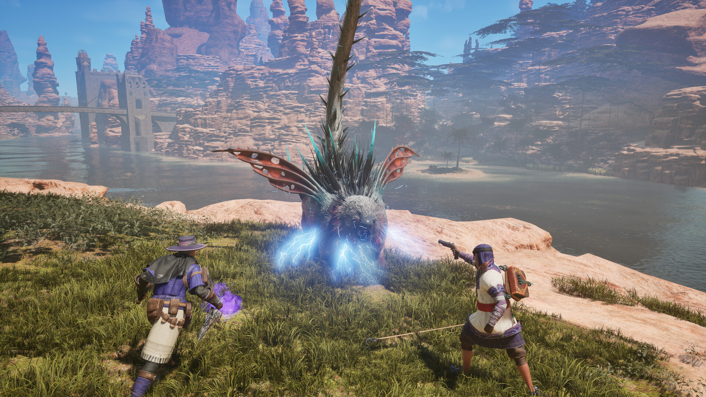
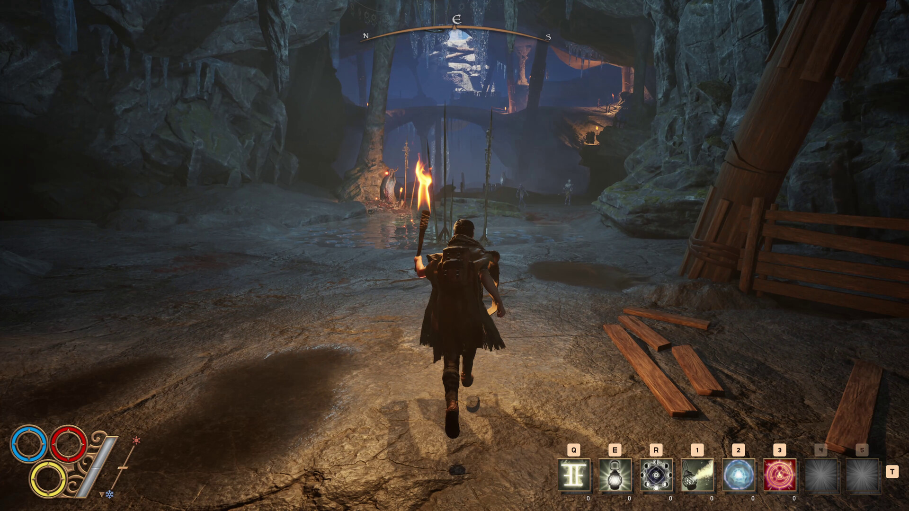

*images gracieuseté de Nine Dots Studio*

**Le studio québécois [Nine Dots Studio](https://www.ninedotsstudio.com/) confirme la date d’entrée en accès anticipé d’[Outward 2](https://store.steampowered.com/app/2161700/Outward_2/) : le RPG d’aventure tant attendu sera disponible le **7 juillet 2026** sur Steam, l’Epic Games Store et GOG. Pour ceux qui ne peuvent pas attendre, une bêta fermée est démarrée hierv le **26 mai**.**

https://www.youtube.com/watch?v=AEDeIEOZs9c

## Un successeur qui assume ses ambitions

*Outward 2* n’est pas une révolution à 180 degrés, mais une évolution affinée de tout ce qui faisait l’identité du premier jeu. Le studio a identifié quatre axes d’amélioration prioritaires : la création et la progression de personnage, la narration, la qualité du monde ouvert et le combat.

> « *Outward 2* est le successeur naturel d’*Outward* et nous voulons surpasser les attentes sur tout ce qui fonctionnait bien. Donner de vraies récompenses à l’exploration, et demander aux joueurs de se préparer et de réfléchir à comment ils réagiraient vraiment face au danger. »
>
> — Guillaume Boucher-Vidal, PDG et directeur créatif, Nine Dots Studio

## Un aventurier ordinaire dans un monde impitoyable

Fidèle à la philosophie du premier jeu, *Outward 2* refuse d’en faire un héros de légende. Le joueur incarne un aventurier ordinaire dans Aurai — un monde ouvert soumis à un cycle saisonnier complet — où la préparation et la réflexion valent plus que la force brute. Laisser tomber son sac à dos avant un combat pour se déplacer librement, tendre des pièges avant d’affronter une créature, gérer ses provisions avec soin : chaque décision a des conséquences. Même la mort ne réinitialise pas la partie — elle en tourne simplement une nouvelle page.

Le jeu introduit notamment un système d’**Exercise** où les compétences passives évoluent selon le style de jeu adopté, un système de **magie rituelle** plus profond, et un mode **coopération à deux joueurs** en écran partagé ou en ligne. Un mulet peut même être acquis pour transporter les provisions — bien que sa vulnérabilité influe sur les chemins à emprunter.

La bêta fermée d’*Outward 2* démarre le **26 mai** — [les inscriptions sont ouvertes sur Steam](https://store.steampowered.com/app/2849490/Outward_2/). L’accès anticipé complet suit le **7 juillet 2026**.

https://www.youtube.com/watch?v=AEDeIEOZs9c

---

📚 **À LIRE AUSSI :** [Nos articles sur Nine Dots Studio](https://mariojramos8.wordpress.com/tag/nine-dots-studio/)
