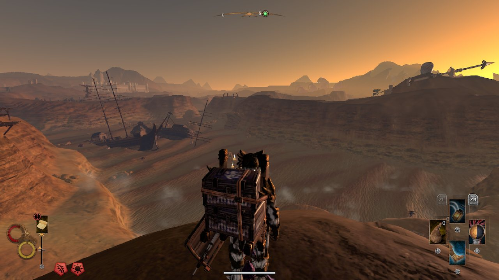
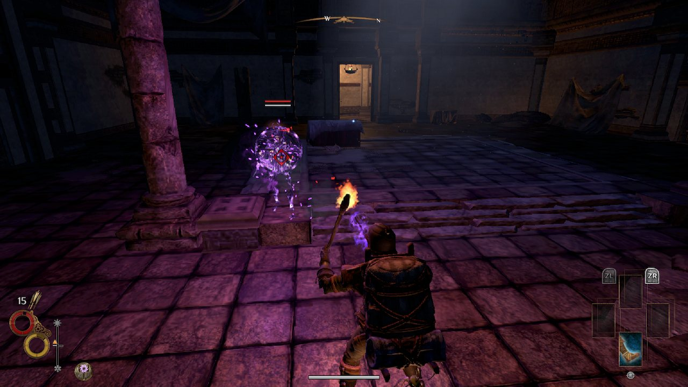
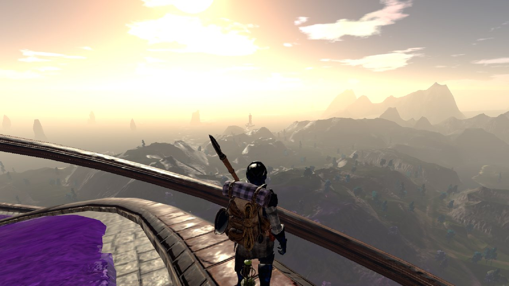
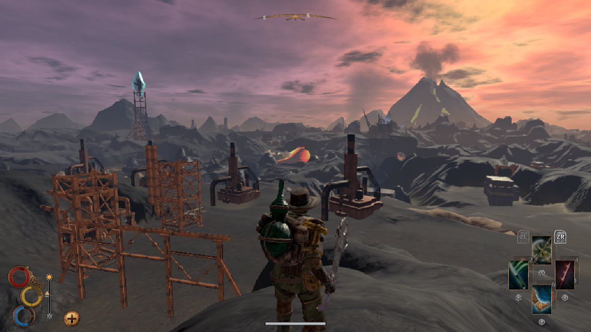
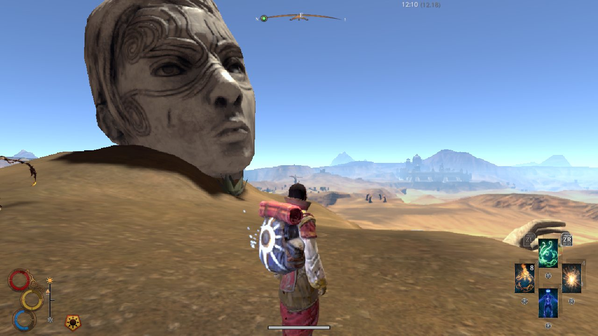
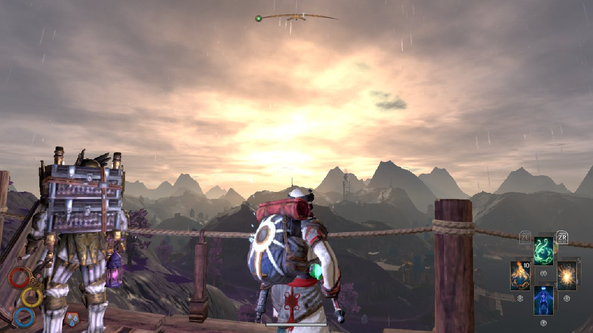

*Image à la une : Nine Dots Studio*

**Le studio québécois [Nine Dots Studio](https://www.ninedotsstudio.com/) a annoncé aujourd’hui une nouvelle qui devrait ravir les propriétaires de Nintendo Switch. Outward, un jeu de rôle à monde ouvert précédemment sorti sur PC, PlayStation, Xbox et feu Stadia, sera bientôt disponible également sur la console hybride de Nintendo.**

L’annonce a été faite aujourd’hui par Guillaume Boucher-Vidal, PDG et directeur créatif de Nine Dots Studio.

Bien que d’amener Outward sur Nintendo Switch était un rêve, Guillaume Boucher-Vidal avait des doutes que ce soit techniquement possible.

> « Outward est un gros jeu qui a été réalisé dans un contexte tellement étrange et qui présente des limitations techniques très spécifiques. (…) L’équipe de Sneaky Box a vraiment sorti un lapin du chapeau avec ce portage. Je suis heureux qu’il y ait une façon supplémentaire de jouer à notre jeu, et avec des appareils comme le Steam Deck et la Nintendo Switch, il est tout à fait approprié que notre jeu soit désormais adapté aux voyages. »
>
> – Guillaume Boucher-Vidal

C’est la version définitive de Outward qui sortira sur Nintendo Switch, qui inclus les DLC The Three Brothers et the Soroboreans.

*Outward est un RPG se déroulant dans le monde d’Aurai dans lequel vous incarnez un aventurier ordinaire se défendant contre des créatures menaçantes, bravant des* *conditions environnementales dangereuses et en essayant de rester en bonne santé et hydraté.* *Votre voyage vous mènera à travers des villes et de dangereux donjons cachés regorgeant d’ennemis redoutables alors que vous voyagez à travers une nature sauvage*.

**Principales caractéristiques:**

- Survivez dans la nature en explorant les terres
- Jouez en solo ou en coopération en ligne
- Scénarios de défaite dynamiques qui réagissent à votre contexte
- La sauvegarde automatique constante signifie qu’il n’y a pas de retour en arrière
- Approche rituelle et étape par étape du lancement de sorts
- Une expérience unique à chaque partie

Voici quelques captures d’écrans tirées de la version Nintendo Switch :

La sortie sur Nintendo Switch est prévue pour 2024.

**À LIRE AUSSI : [Les jeux vidéo faits au Québec attendus en 2024](/2023/12/14/les-jeux-video-faits-au-quebec-attendus-en-2024/)**
