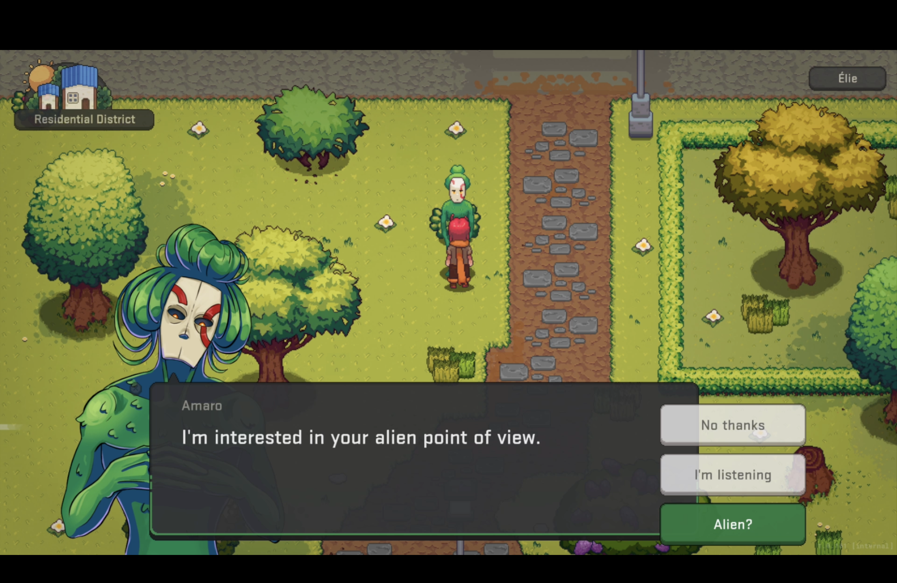
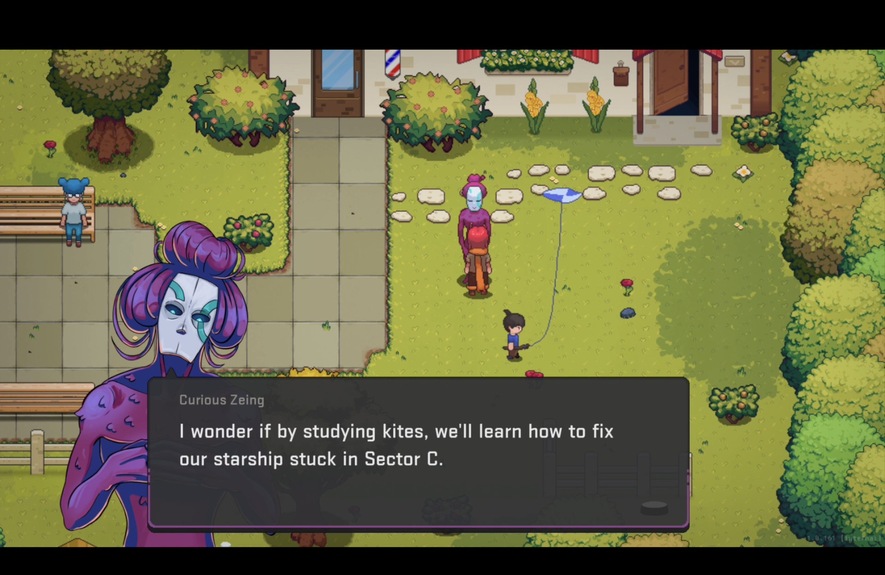
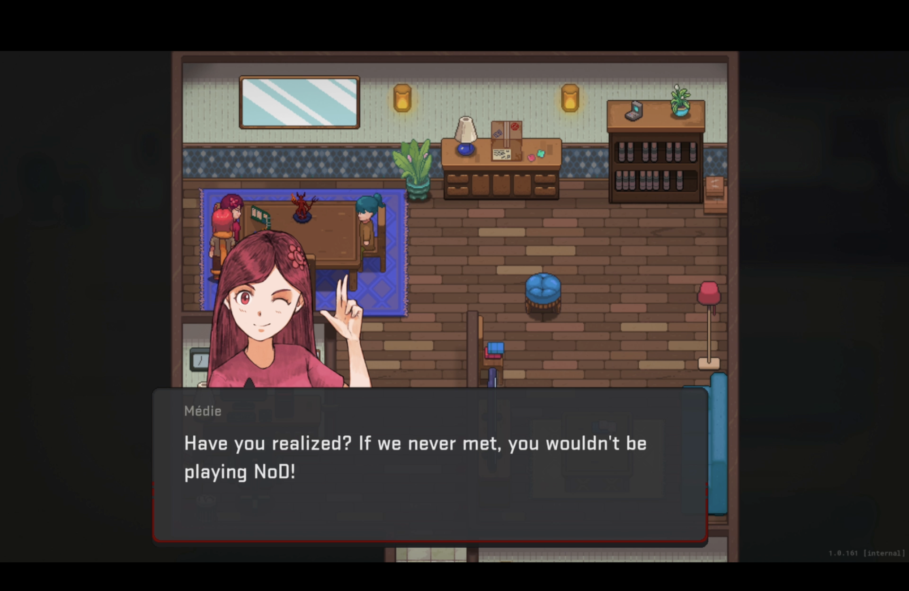
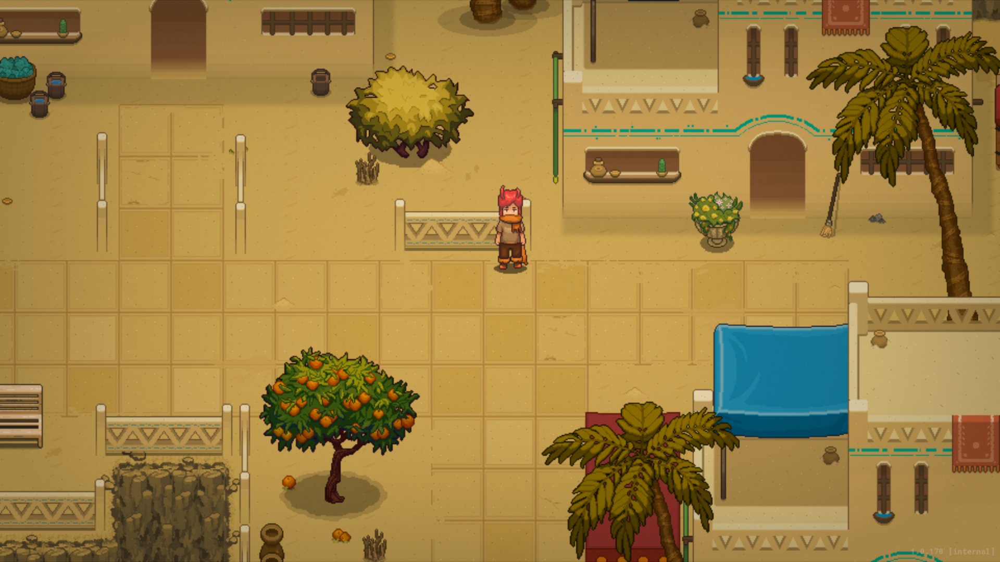
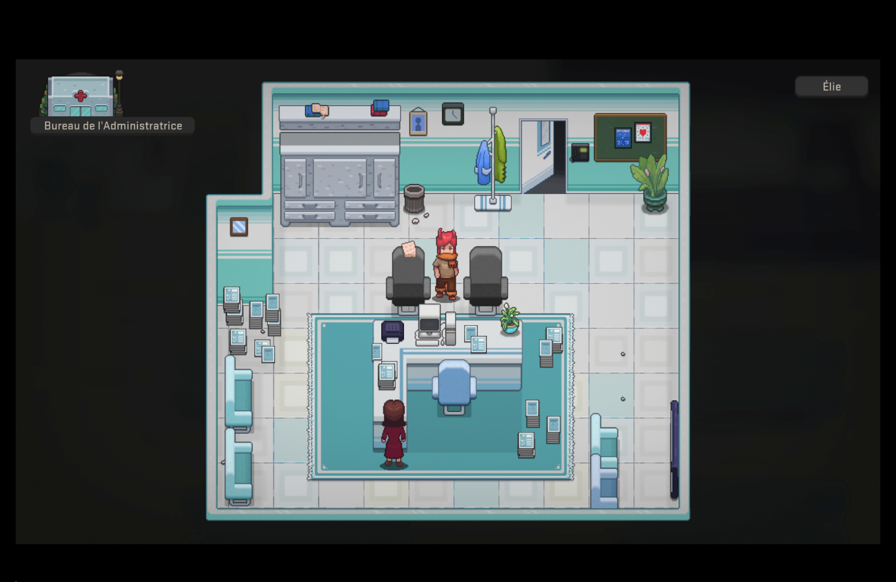
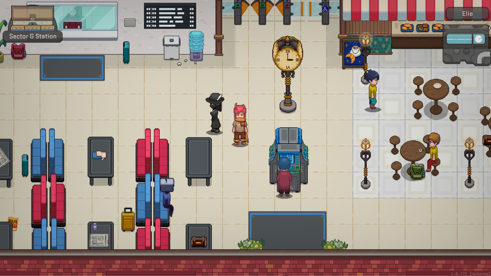
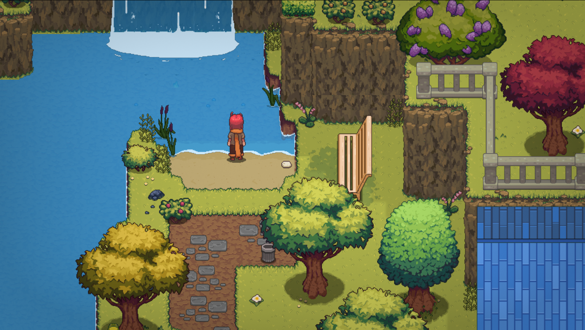

**Le nouveau studio québécois [Ivalys](https://www.studiosivalys.ca/) annonce Pluralys, un jeu de rôle d’exploration et narratif qui mélange humour et mystère.**

Dans **Pluralys**, on incarne Élie, un jeune garçon menant une vie paisible… jusqu’à l’arrivée de visiteurs inattendus. L’un d’eux lui transmet un message étrange : **tu es le seul capable de changer le cours des événements.**

[Une démo est actuellement disponible sur Steam dans le cadre du Steam NextFest.](https://store.steampowered.com/app/3275440/Pluralys/)

Rejoignez la communauté Discord du jeu [ici.](https://discord.com/invite/D2Qq2ZgJzg)

**Quelques captures d’écrans du jeu :**

**À LIRE AUSSI : [Premières impressions : l’audace uchronique de Bonaparte : A Mechanized Revolution](/2025/05/22/premieres-impressions-laudace-uchronique-de-bonaparte-a-mechanized-revolution/)**
