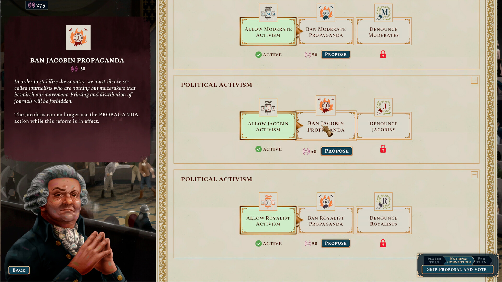
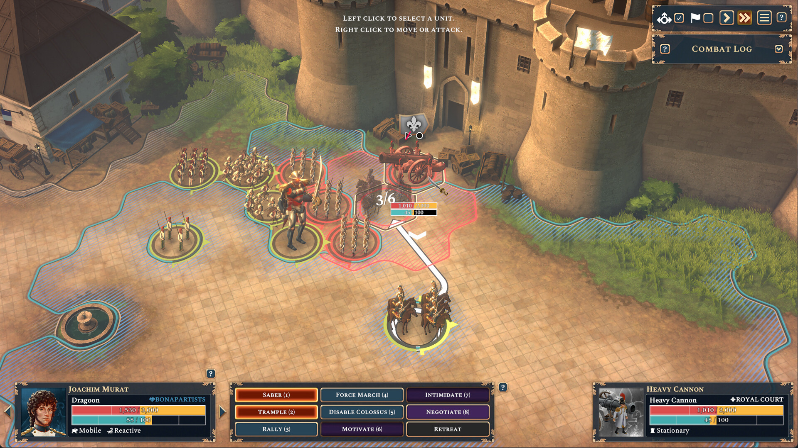
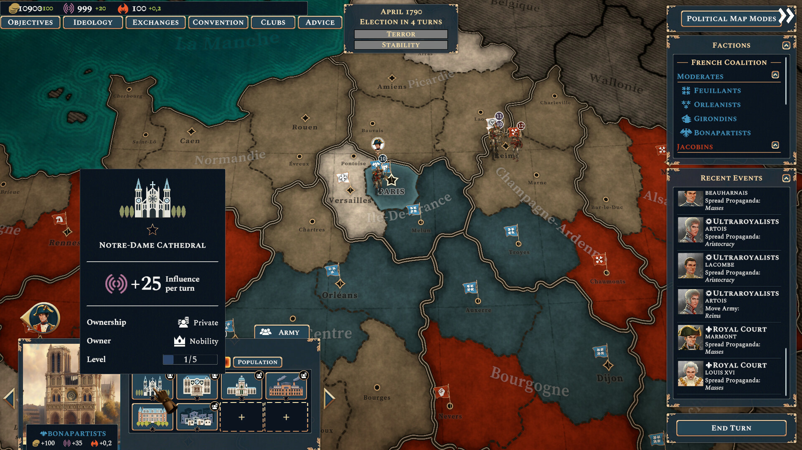
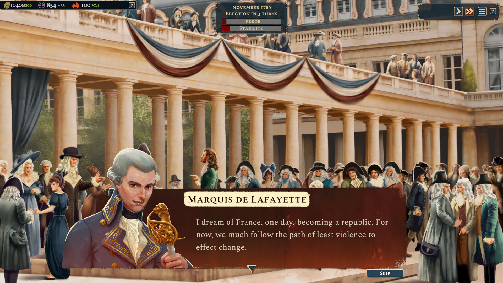
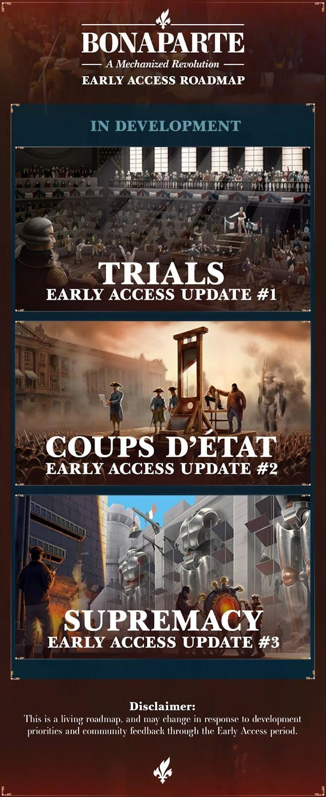

*images et copie du jeu gracieuseté de Studio Imugi*

**Le [Studio Imugi](https://www.linkedin.com/company/studio-imugi/?originalSubdomain=ca) nous plonge dans une France de 1789 revisitée avec *[Bonaparte : A Mechanized Revolution](https://store.steampowered.com/app/2560340/Bonaparte__A_Mechanized_Revolution/)*, un jeu de grande stratégie qui ose mélanger la poudre à canon avec le souffle du phlogiston de colosses mécaniques. Dès les premières heures, le titre détonne par son approche uchronique audacieuse, offrant au joueur la possibilité d’incarner un Napoléon alternatif, César ou Céline Bonaparte, prêt à façonner le destin de la France selon ses propres desseins.**

https://www.youtube.com/watch?v=Ta7TY0VysKw

La force majeure de *Bonaparte* réside dans sa liberté politique. Au lieu de suivre les chemins tracés par l’Histoire, le joueur peut choisir de rallier la Révolution, de préserver la monarchie, ou d’opter pour une voie plus modérée, créant ainsi une expérience profondément rejouable. Cette liberté s’étend bien au-delà des champs de bataille. Le jeu intègre avec brio une dimension politique et sociale.

Gagner le support des factions rivales par la propagande ciblée est tout aussi important que le déploiement tactique. Les sessions de la Convention Nationale, où l’on vote pour ou contre des réformes déterminantes – du droit de vote aux exécutions – ajoutent une profondeur stratégique au jeu.

L’immersion est renforcée par une narration ponctuée de scénarios dynamiques. Que ce soit la tentative de fuite de Louis XVI en Autriche ou les soubresauts d’une contre-révolution, ces événements historiques détournés injectent une dose bienvenue de chaos et d’opportunités. Les figures emblématiques de l’époque, de Robespierre au Marquis de Lafayette, sont intégrées avec intelligence, ajoutant une couche d’authenticité et un attrait certain pour les passionnés d’histoire. L’ajout des colosses mécaniques, fonctionnant au mystérieux phlogiston, apporte une touche de fantaisie bien dosée.

Certains aspects de l’interface utilisateur manquent par contre d’intuitivité. Le recrutement de bataillons et d’officiers, en particulier, n’est pas tout de suite évident à saisir. De même, plusieurs mécaniques restent peu ou mal expliquées, nécessitant une exploration par tâtonnements pour en saisir toutes les subtilités.

Cela étant dit, il faut rappeler que le jeu est actuellement en phase Accès Anticipé sur Steam. Ce qui veut dire que le jeu est toujours en développement et que la rétroaction des joueurs est cruciale à son évolution.

D’ailleurs, Studio Imugi a partagé sa feuille de route concernant les mises à jour prévues:

*Bonaparte : A Mechanized Revolution* pose une base solide et prometteuse. Son mélange audacieux de grande stratégie historique, de liberté politique et d’éléments uchroniques en fait une expérience unique et captivante. Imugi a su créer un univers où la Révolution française est non seulement rejouable, mais aussi réinventée, offrant un potentiel immense pour les mises à jour à venir. Un titre à suivre de près pour tout amateur de jeux de stratégie désireux de réécrire l’Histoire à coups de réformes politiques et de colosses de phlogiston.

### VERDICT : 8 – TRÈS BON

**À LIRE AUSSI : [Gameloft Montréal inaugure ses nouveaux locaux et souffle 25 bougies](/2025/05/18/gameloft-montreal-inaugure-ses-nouveaux-locaux-et-souffle-25-bougies/)**
