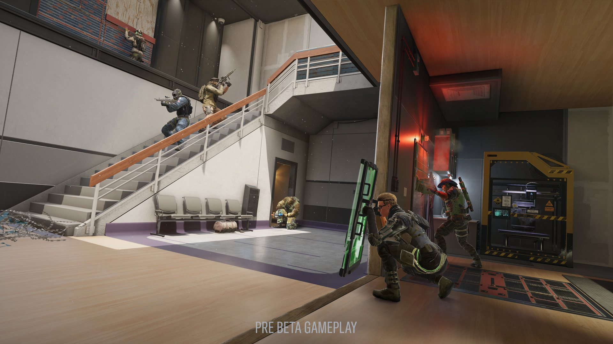
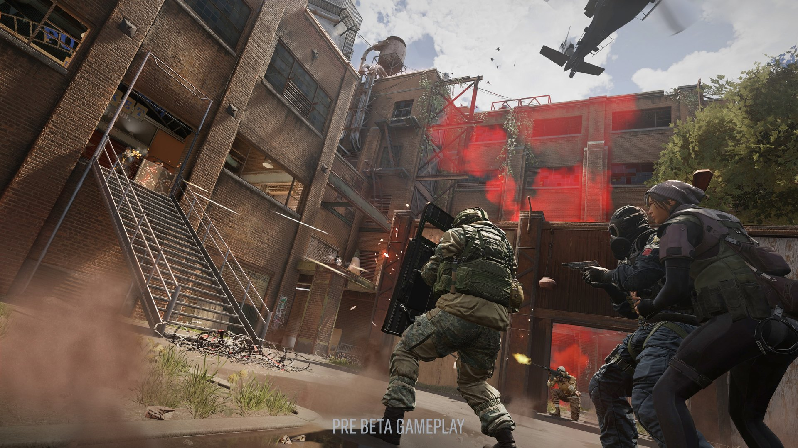
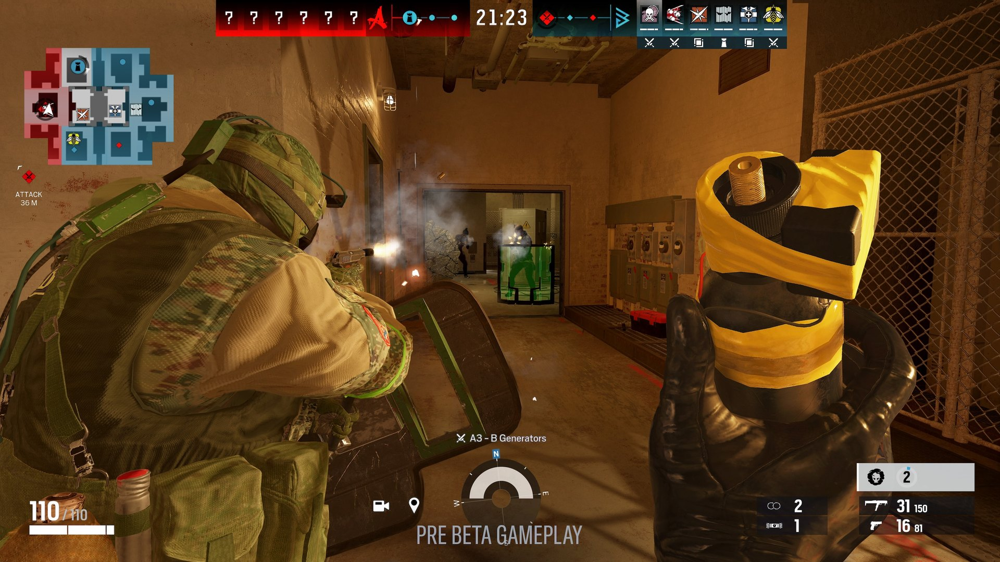
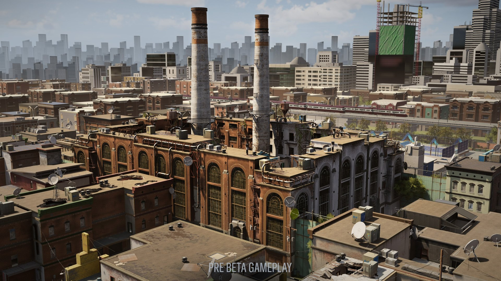
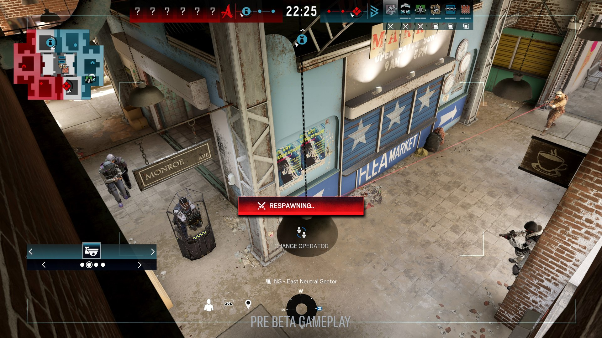
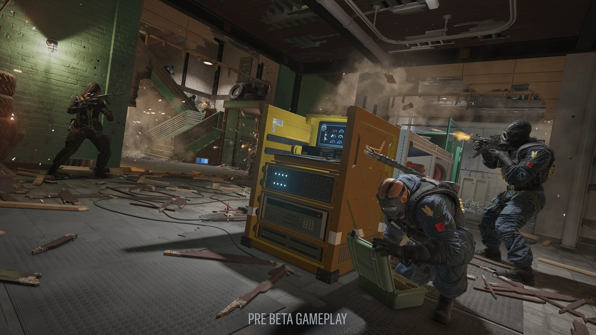

*image gracieuseté de Ubisoft Montréal*

**[Ubisoft Montréal](https://montreal.ubisoft.com/fr/) vient d’annoncer que [Tom Clancy’s Rainbow Six Siege X](https://www.ubisoft.com/en-us/game/rainbow-six/siege) sera disponible le 10 juin prochain. Cette mise à jour gratuite, qualifiée comme « l’évolution la plus importante de l’histoire de la franchise », apporte des changements majeurs tant au niveau de la jouabilité que des fonctionnalités techniques.**

https://www.youtube.com/watch?v=A0Hw96M5bC4

## Dual Front : Un nouveau mode de jeu révolutionnaire

L’ajout le plus important est sans doute le nouveau mode permanent **Dual Front**. Ce mode 6v6 inédit introduit une dynamique de jeu révolutionnaire pour la franchise :

- Les joueurs devront simultanément attaquer pour sécuriser 3 secteurs ennemis tout en défendant leur propre territoire
- Une carte exclusive baptisée “District” a été spécialement conçue pour ce mode
- Pour la première fois, les joueurs pourront sélectionner parmi une liste de 35 opérateurs mélangeant attaquants et défenseurs
- Une zone neutre permettra d’accomplir des missions temporaires offrant des avantages stratégiques
- La possibilité de réapparaître et de changer d’opérateur apporte une flexibilité tactique inédite

Une bêta fermée de ce mode est disponible dès maintenant jusqu’au 19 mars sur PlayStation 5, Xbox Series X|S et PC via Ubisoft Connect. L’accès peut être obtenu via des Twitch Drops en regardant les streams de créateurs de contenus partenaires.

## Améliorations graphiques et techniques

- Les cartes classiques (Clubhouse, Chalet, Banque et Café) bénéficieront d’éclairages améliorés, d’ombres retravaillées et de textures en 4K
- Trois cartes supplémentaires seront modernisées à chaque saison
- De nouveaux éléments destructibles (extincteurs, conduites de gaz, détecteurs de métaux) enrichiront les possibilités tactiques
- La navigation en rappel sera plus fluide avec des contrôles améliorés permettant de se déplacer horizontalement et de contourner les angles
- L’expérience audio sera entièrement retravaillée pour une meilleure immersion et des informations sonores plus précises

## Lutte contre la triche renforcée

La mise à jour introduira également le **R6 ShieldGuard**, une approche multifacette de lutte contre la triche :

- Unification de toutes les initiatives antitriches existantes
- Introduction de nouvelles technologies de protection
- Mises à jour de sécurité en temps réel sans maintenance planifiée
- Système de réputation amélioré pour lutter contre la toxicité

## Passage à un modèle free-to-play

À partir du 10 juin, Rainbow Six Siege adoptera un modèle économique partiellement gratuit :

- Les nouveaux joueurs auront un accès gratuit aux modes Dual Front, Non classé et partie rapide
- Possibilité de débloquer jusqu’à 26 opérateurs via la progression
- Le passage aux éditions premium permettra de débloquer le mode classé, la Siege Cup après le niveau 50, et un accès immédiat à davantage d’opérateurs
- Les joueurs actuels conserveront tout leur contenu déjà débloqué et recevront des récompenses exclusives selon leur ancienneté

## RELOAD : Un événement esport de préparation

En amont de la sortie, les fans pourront assister à une compétition esport baptisée **RELOAD**, qui se déroulera du 8 au 18 mai à Rio de Janeiro. Les joueurs professionnels s’affronteront sur les nouvelles cartes modernisées de Rainbow Six Siege X.

## Disponibilité

Tom Clancy’s Rainbow Six Siege X sera disponible sur plusieurs plateformes :

- Ubisoft+ (le service d’abonnement d’Ubisoft)
- PlayStation 4 et 5
- Xbox One et Series X|S
- PC (Windows, Steam)
- Amazon Luna

À noter que le mode Dual Front sera exclusivement disponible sur PC, PlayStation 5 et Xbox Series X|S, marquant ainsi une transition progressive vers la nouvelle génération de consoles.

**À LIRE AUSSI : [L’Orchestre de Jeux Vidéo dévoile son nouveau concert « MetroidVania »](/2025/03/13/lorchestre-de-jeux-video-devoile-son-nouveau-concert-metroidvania/)**
