*images : gracieuseté de Red Barrels* *et les Canadian Game Awards*

**Fondé à Montréal en 2011 par Philippe Morin, David Châteauneuf et Hugo Dallaire, [Red Barrels](https://redbarrelsgames.com/) a lancé avec éclat les festivités de son 15e anniversaire lors de la cérémonie des [Prix du jeu canadien](https://mariojramos8.wordpress.com/2026/05/27/le-quebec-brille-aux-canadian-game-awards/), le 21 mai à Toronto. Ce studio indépendant montréalais, qui a commencé avec une dizaine d’employés, en compte aujourd’hui plus de 80 et a écoulé plus de 50 millions d’exemplaires de ses jeux de la franchise *Outlast* à travers le monde.**

https://www.youtube.com/watch?v=jTDs3QGrFn4

## Une franchise qui a effrayé la planète

Lors de la soirée, le cofondateur Philippe Morin est monté sur scène pour présenter la catégorie du Meilleur jeu indépendant, tandis que le studio diffusait une vidéo anniversaire retraçant le parcours de la franchise ***Outlast***.

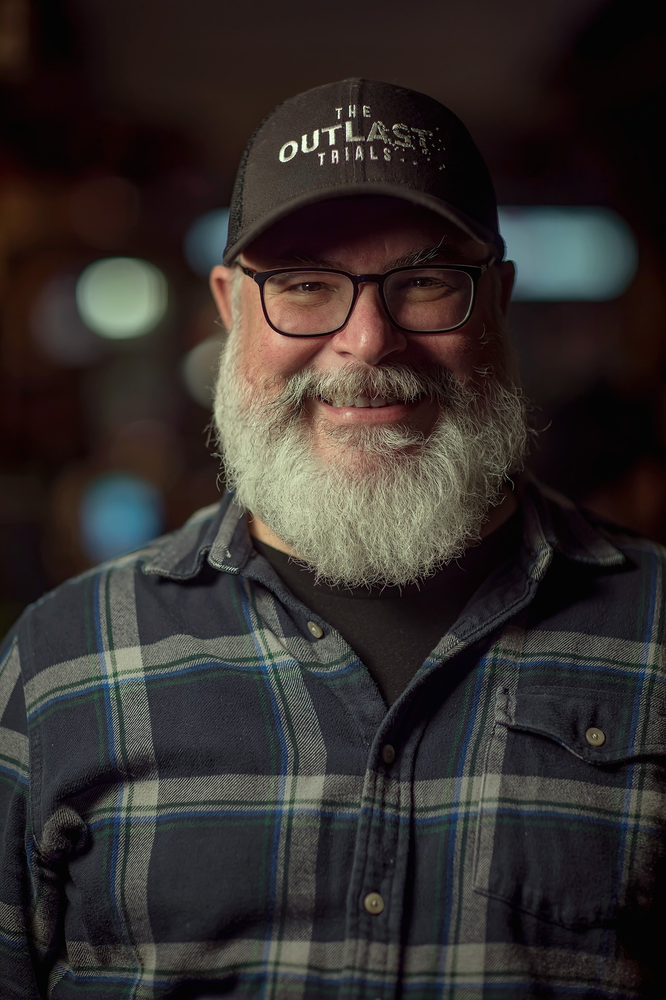

*Philippe Morin*

*Hugo Dallaire*

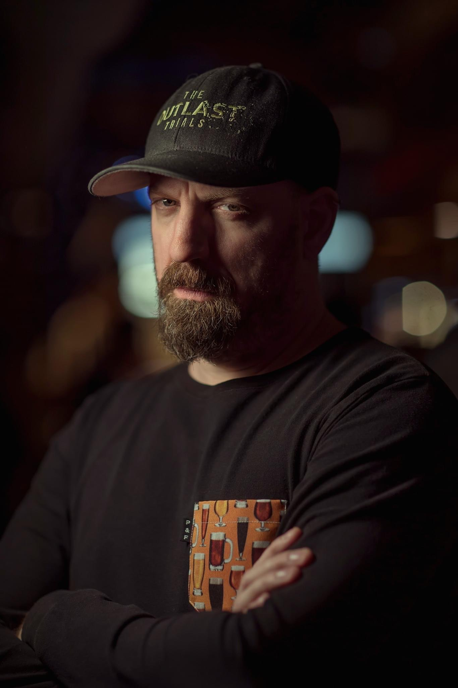

*David Chateauneuf*

**Au fil des ans, tant Red Barrels qu’*Outlast* ont récolté divers prix et nominations dans de prestigieux concours nationaux et mondiaux :**

- **Meilleur développeur** / [Horror Games Awards](https://www.thehorrorgameawards.com/) 2025
- **Meilleure piste audio** pour un jeu indépendant / [Game Audio Network Guild Awards](https://www.audiogang.org/awards/) 2025
- **Meilleur design sonore** pour un jeu indépendant / Game Audio Network Guild Awards 2025
- **Meilleur jeu d’horreur multijoueur** (*The Oulast Trials*) / Horror Games Awards 2023
- **Jeu favori des joueurs** (*Outlast*) / Prix du jeu canadien 2014

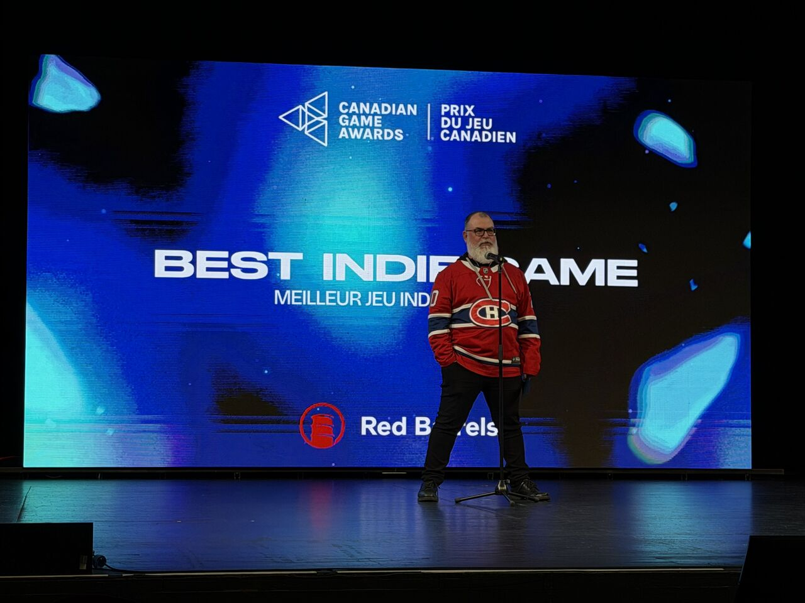

****Philippe Morin, fier partisan du CH, PDG et co-fondateur de Red Barrels, aux Canadian Game Awards****

Lancé en 2013, ***Outlast*** et ses suites ont généré plus de 230 millions de dollars de revenus à l’échelle planétaire. La recette : une perspective à la première personne, aucun combat, et une tension narrative qui a défini un sous-genre entier du jeu d’horreur.

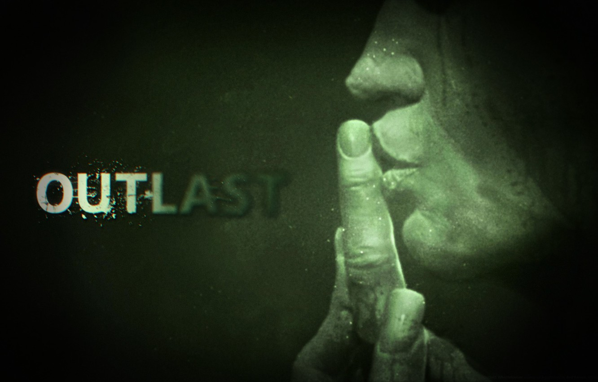

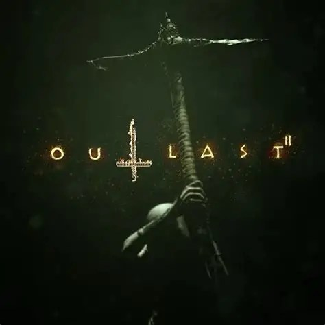

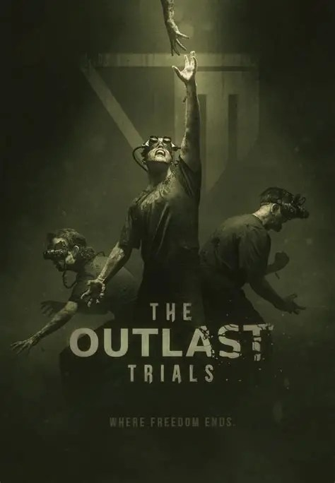

**À LIRE AUSSI : [The Outlast Trials – La saison 6.1 Prime Time est maintenant disponible](https://mariojramos8.wordpress.com/2026/05/20/the-outlast-trials-la-saison-6-1-prime-time-est-maintenant-disponible/)**

> « *Cet événement rassembleur constitue une plateforme importante pour honorer et faire rayonner les artisans d’ici. Red Barrels fait sa part afin de le soutenir, tout en profitant de sa tenue pour déclencher nos propres festivités.* »
>
> **Philippe Morin, cofondateur et PDG de Red Barrels**

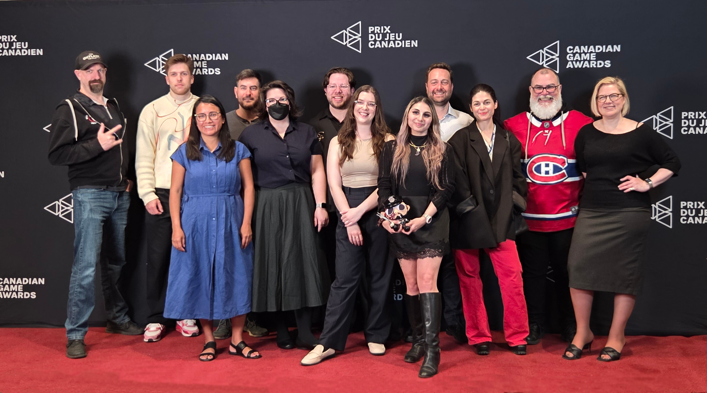

****Une partie de l’équipe de Red Barrels****

## Des éloges de l’industrie

> « *Ce qui est fascinant avec Red Barrels, c’est qu’ils ont bâti quelque chose qui leur ressemble totalement, et le monde entier l’a reconnu. Depuis Montréal, ils ont créé Outlast avec un parti pris créatif assumé, ont rejoint des joueurs aux quatre coins du globe, et ce, en préservant leur indépendance. En tant que Canadien, c’est toujours une fierté de voir un studio de chez nous grandir avec le temps et s’attirer une reconnaissance mondiale. Red Barrels nous rappelle que certains des univers de jeux les plus marquants au monde peuvent naître de petites équipes prêtes à prendre des risques et à faire confiance à leur propre voix..* »
>
> – **Geoff Keighley – Créateur et animateur des Game Awards**

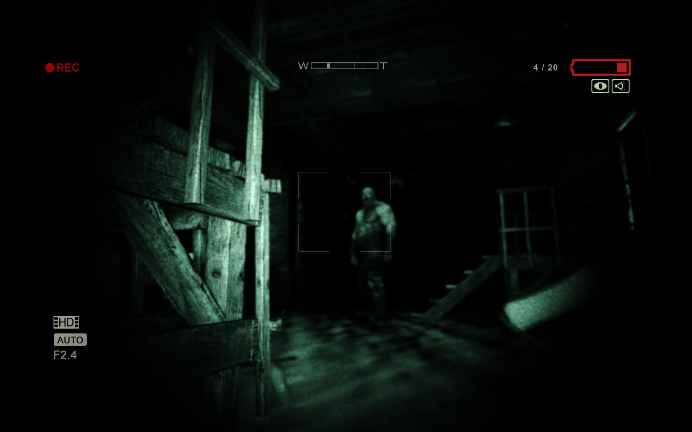

***Le premier Outlast est sorti en 2013 et s’est écoulé à plus de 20 millions de copies**, **suivi du DLC Outlast : Whistleblower***

> « *Red Barrels démontre à quel point la créativité québécoise peut rayonner au-delà de nos frontières*. *Portée par une vision créative forte, son équipe a forgé une voix distincte dans l’horreur, proposant des titres reconnus mondialement et ayant marqué les esprits de façon durable. Son travail constitue un exemple percutant de la manière dont une propriété intellectuelle québécoise originale peut façonner notre empreinte culturelle, contribuer à l’économie d’ici et renforcer notre position sur la scène internationale.* »
>
> **– Émilien Roscanu, directeur principal, communications et opérations, de La Guilde du jeu vidéo du Québec**

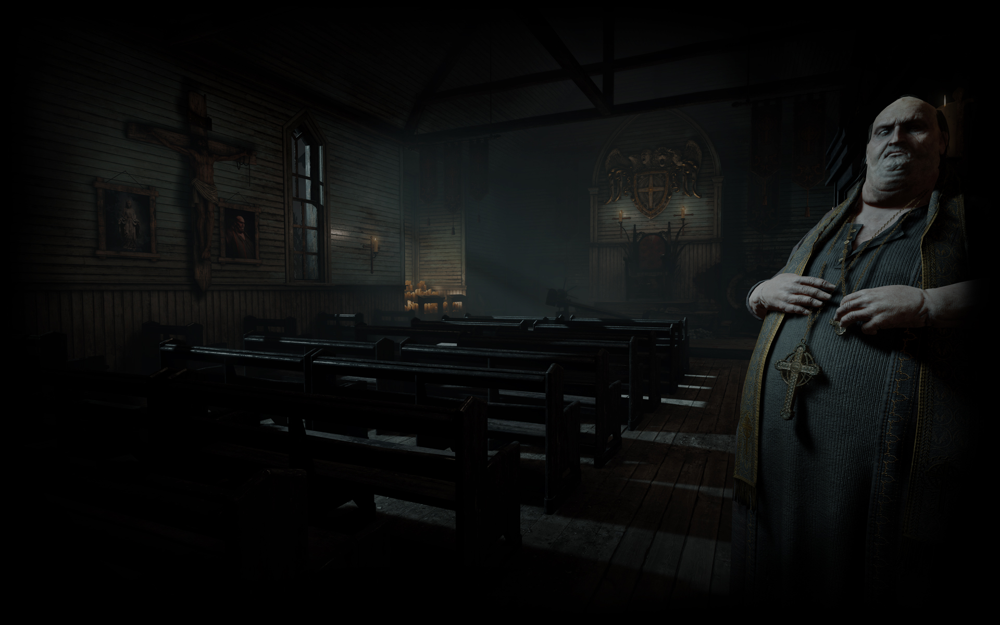

***Outlast 2, sorti en 2017, a connu un succès critique et commercial similaire au premier opus***

> « *En 15 ans, le studio a développé des propriétés originales qui touchent des joueurs aux quatre coins du monde. Cela prouve que les studios indépendants d’ici peuvent rivaliser au plus haut échelon. Le succès d’**Outlast** et de ses suites démontre, clairement et sans complexe, que nos jeux méritent d’être cités au même titre que n’importe quelle œuvre créative produite chez nous.* »
>
> **– Valerie Creighton, présidente et chef de la direction** **du Fonds des Médias du Canada**

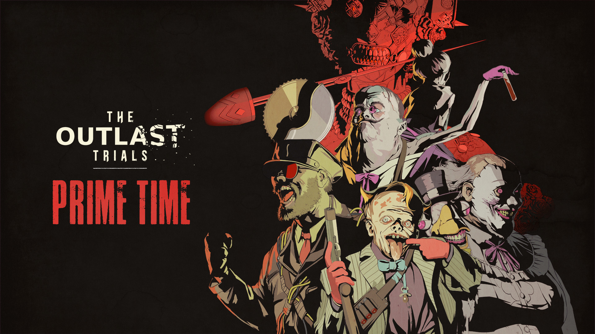

> « *Cela fait quinze ans que Red Barrels s’est lancé dans la création d’une expérience unique, et ce faisant, ils ont inspiré toute une génération de développeurs de jeux canadiens à prendre des risques audacieux sur des idées originales. Leur parcours est une belle histoire de succès pour l’industrie du jeu vidéo, illustrant la détermination et la vision singulières qui définissent le développement de jeux au Canada. Aux Canadian Game Awards, nous sommes fiers de célébrer leur impact ici, chez nous, comme sur la scène mondiale.* »
>
> **– Carl-Edwin Michel, Fondateur des Canadian Game Awards**

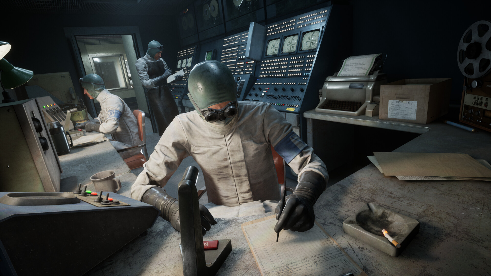

***The Outlast Trials a atteint son premier million de copies vendues alors que le jeu était encore en accès anticipé***

> « *Dans un paysage autrefois dominé par des géants du AAA à capitaux étrangers, Red Barrels s’est imposé comme un véritable exemple éclatant de réussite pour un studio indépendant canadien*. *Alors que les jeux indépendants n’étaient à peine qu’une réalité en 2011, les fondateurs ont persévéré et ont fini par bâtir l’une des franchises d’horreur les plus chéries au monde avec **Outlast**. Bravo !* »
>
> **– Jason Della Rocca, co-fondateur de Execution Labs**

## Un nouveau projet en développement

Red Barrels ne s’arrête pas là. En plus de continuer à enrichir ***The Outlast Trials,*** le studio confirme être en développement sur un nouveau projet encore non dévoilé, promettant des frissons plus forts et plus intenses que jamais.

Pour souligner l’étape en grand, une soirée spéciale avait lieu le 26 mai au Centre d’entreprises et d’innovation de Montréal (CEIM), où les dirigeants revenaient sur les premières années du studio et les choix stratégiques qui ont forgé l’ADN de Red Barrels.

Aussi, pour l’occasion, le studio a lancé une nouvelle collection de marchandises disponibles sur leur [boutique en ligne.](https://store.redbarrelsgames.com/collections/15-year-anniversary-collection)

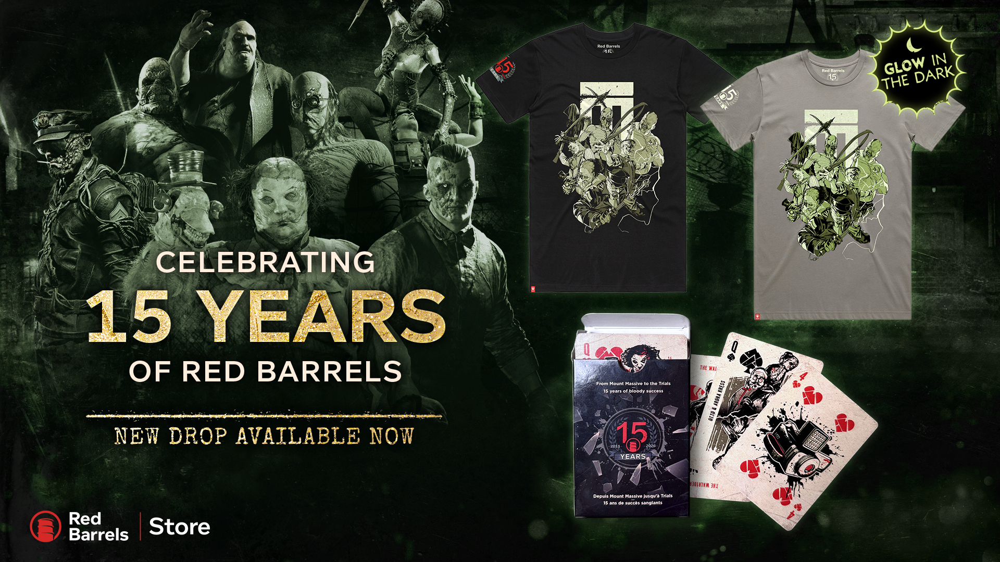

---

📚 **À LIRE AUSSI :** [Nos articles sur The Outlast Trials](https://mariojramos8.wordpress.com/tag/the-outlast-trials/)
