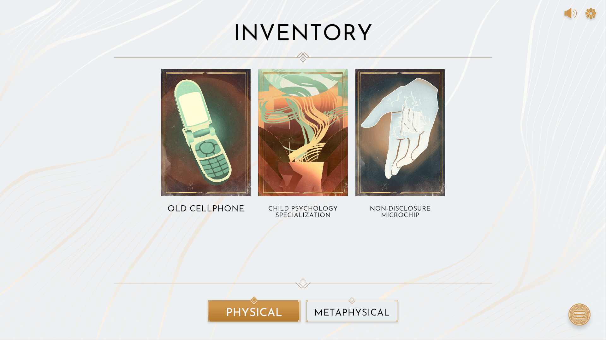

*images gracieuseté de l’[Indie Asylum](https://www.indieasylum.com/)*

***[Ressources inhumaines](https://store.steampowered.com/app/3379360/Inhuman_Resources_A_Literary_Machination/)* est une création conjointe du développeur montréalais [Affordance Studio](https://affordancestudio.com/), de la maison d’édition [Éditions Alto](https://editionsalto.com/) et [Moteurs Finnegan](https://www.finneganmotors.com/fr). Ce titre unique en son genre combine les codes du jeu vidéo et du livre pour offrir une expérience immersive où les décisions du joueur façonnent le récit.**

Décrit comme un thriller interactif mêlant satire anticapitaliste et horreur psychologique, *Ressources inhumaines* plonge le joueur dans la peau d’un nouvel employé de SMYRNACORP, une entreprise se présentant comme spécialiste en ressources humaines mais confrontée à une étrange pénurie de personnel. L’apparente normalité des débuts se fissure rapidement, laissant place à la découverte d’activités suspectes et d’objectifs bien plus sinistres que de simples recrutements.

https://videopress.com/v/kTL7sRyE

Au fil de l’aventure, le joueur devra résoudre des énigmes cryptiques, examiner des extraits vidéo, faire des choix cornéliens, s’introduire dans des systèmes informatiques et forcer des coffres-forts pour dévoiler la vérité derrière cette organisation anachronique. La question centrale demeure : parviendra-t-il à échapper à l’emprise de SMYRNACORP sans perdre la raison ?

> *« Comme dans des séries telles que Lost (Perdus) ou Severance (Dissociation), on y obtient des réponses à nos questions, mais, en revanche, davantage de questions surgissent invariablement par la suite. »*
>
> – **Antoine Tanguay, fondateur des Éditions Alto**

> *« Les gens ont soif pour un tel jeu, où leurs décisions auront un véritable impact et où l’intrigue persiste jusqu’à la fin. »*
>
> **Pascal Nataf, cofondateur d’Affordance Studio**

Le jeu se contrôle aisément avec seulement deux doigts, que ce soit sur PC ou sur appareil mobile. Cette simplicité permet aux lecteurs habitués de se concentrer sur le récit, tandis que les joueurs expérimentés trouveront de nombreuses opportunités d’interaction avec l’histoire.

Le jeu a été développé sous l’égide de Moteurs Finnegan, une entité née de la collaboration entre Affordance Studio et Éditions Alto; le collectif Indie Asylum a également apporté sa contribution au développement du projet.

*Ressources inhumaines* est disponible dès le 16 avril sur [Steam](https://store.steampowered.com/app/3379360/Inhuman_Resources_A_Literary_Machination/) pour PC au prix de 14,99 $ et sur les plateformes mobiles [iOS](https://apps.apple.com/us/app/inhuman-resources/id6741593429) et Android au prix de 7,99 $.

Un démo est présentement disponible sur Steam.

**À LIRE AUSSI : [Après les Tortues Ninjas, le studio québécois Tribute s’attaque à Marvel](/2025/03/27/apres-les-tortues-ninjas-le-studio-quebecois-tribute-sattaque-a-marvel/)**
