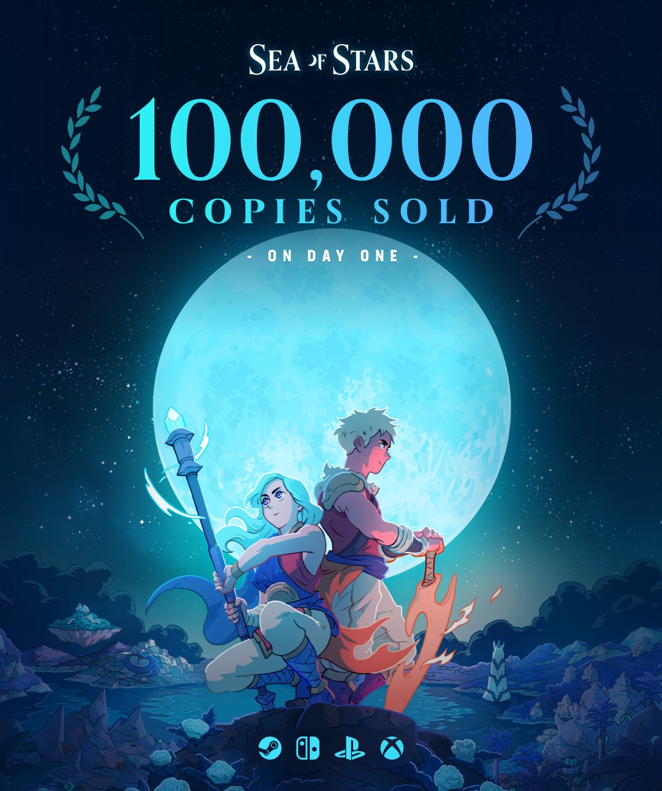

*crédit images : Sabotage Studio*

## C’est un lancement canon pour [Sea of Stars](/2023/08/21/5-choses-a-savoir-sur-sea-of-stars/), le 2e jeu du studio québécois [Sabotage](https://sabotagestudio.com/), qui en à peine 24 heures a vendu plus de 100 000 copies sur PC, PlayStation, Xbox et Nintendo Switch.

Le jeu est disponible sur consoles et PC depuis le 29 août 2023 et connait déjà un succès critique avec des notes de 8-9-10 sur 10, un peu partout. Sea of Stars s’enligne également pour connaître un succès commercial.

Ce n’est pas surprenant, le premier effort de Sabotage, The Messenger, a marqué l’année 2018 comme un des meilleurs jeux de l’année. Quand il a été annoncé que Sea of Stars s’inspirait notamment de Chrono Trigger, le *buzz* et les attentes étaient hautes. En plus que le légendaire compositeur de Chrono Trigger, [Yasunori Mitsuda, participe à la trame sonore de Sea of Stars.](https://www.facebook.com/SabotageQC/posts/pfbid02ExnXC5TVNBudYqxVdX4KLnHxevDxAxxCXBCheiZ51CKzonA8fyMyUVccsPws9m6Hl?__cft__[0]=AZWPH2OUVMzlRdD4vY5GFejl9rkaSpsBw4m7Zg4nhQHhuKf9oa4jAtoj6EYazSV3EuqakGiAn6tDuVmPIDJDeB3Lu9cmu7HHSlp1seVdIkEWZCRw_wC94ZeKtz7Orl_gca_sg9t7rKF7dgU4AzF2t2F4pyqxMi4GUnWwZTRlqcl11DMF9OiGBh8ctJ7RJtCtBCY&__tn__=%2CO%2CP-R)

Sabotage Studio a fait l’annonce ce matin sur ses réseaux sociaux que Sea of Stars s’est écoulé à 100 000 copies en 24 heures.

**À LIRE AUSSI : [Les 20 meilleurs jeux faits au Québec, selon Metacritic](/2023/08/19/les-20-meilleurs-jeux-faits-au-quebec-selon-metacritic/)**

Voici la bande-annonce de lancement :

https://www.youtube.com/watch?v=yt7A9HNy5XM

**À LIRE SUR BÊTA-TESTEUR : [Critique de Sea of Stars](https://www.lebetatesteur.ca/test-sea-of-stars-et-lart-de-faire-un-retro-rpg-sur-la-coche/)**
