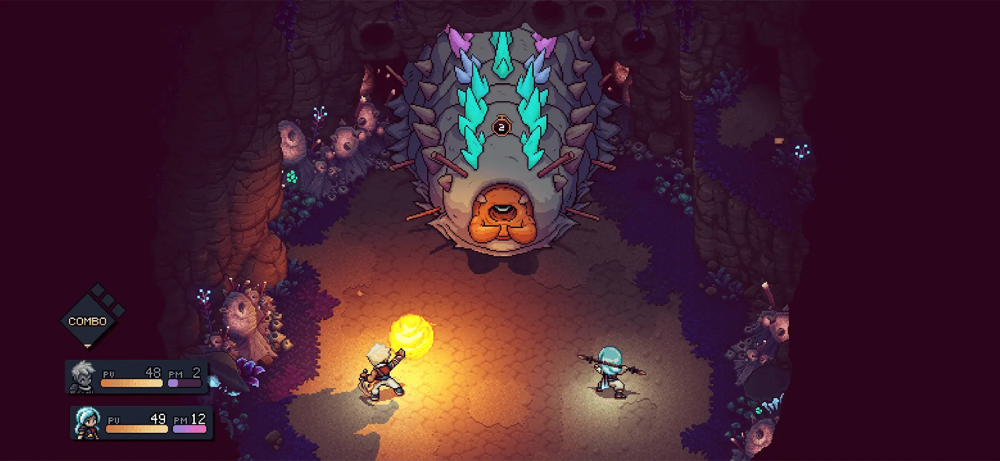
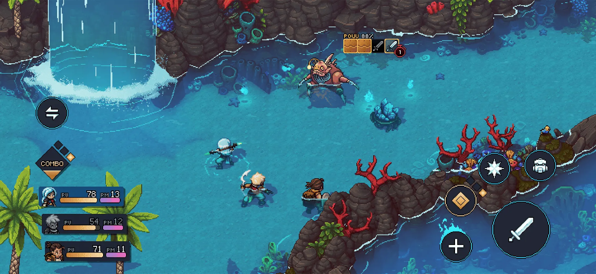

*images gracieuseté de Sabotage Studio*

**[Sabotage Studio](https://www.sabotagestudio.com/), le studio de** **Québec derrière le jeu de rôle acclamé [*Sea of Stars*](https://store.steampowered.com/app/1244090/Sea_of_Stars/), vient d’élargir considérablement son audience : le jeu est désormais disponible sur iOS via l’App Store et sur Android via Google Play. Un lancement mobile qui ouvre le titre à un tout nouvel écosystème de joueurs.**

## Sea of Stars : un bijou du RPG indépendant

Sorti en août 2023 sur PC et consoles, *Sea of Stars* a été l’une des belles surprises dans le monde du jeu indépendant. S’inspirant des grands RPG des années 90 comme *Chrono Trigger*, le jeu a séduit par sa direction artistique lumineuse, sa mécanique de combat originale et sa musique signée Yasunori Mitsuda. Les récompenses ont suivi : nominations aux Game Awards, Best Indie aux BAFTA, et une réception critique unanime.

## Le mobile, un marché stratégique

Le marché du jeu mobile représente aujourd’hui plus de la moitié des revenus mondiaux du jeu vidéo. Pour un RPG narratif comme *Sea of Stars*, le format mobile est pertinent : les sessions peuvent être réalisées en courtes tranches, ce qui correspond aux habitudes des joueurs mobiles.

---

📚 **À LIRE AUSSI :** [Sea of Stars : la version québécoise est maintenant disponible](https://mariojramos8.wordpress.com/2024/11/13/sea-of-stars-la-version-quebecoise-est-maintenant-disponible/)
