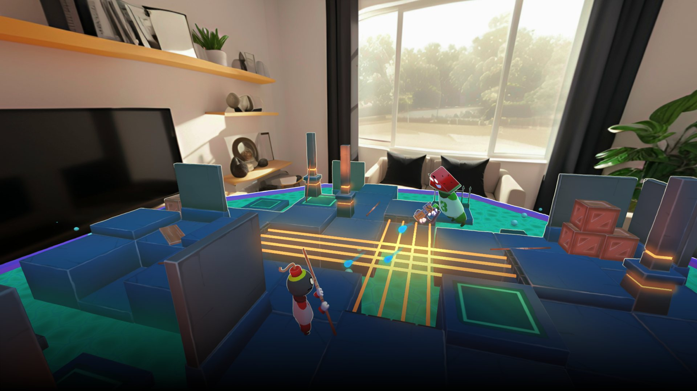
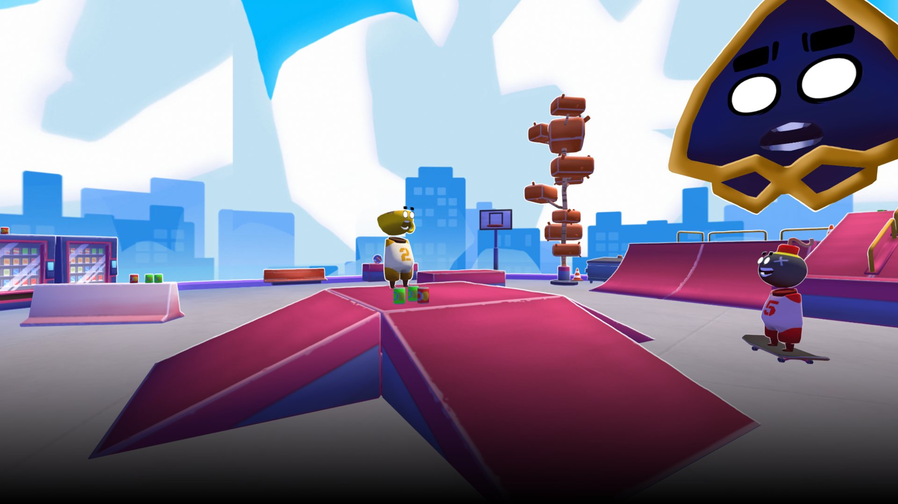
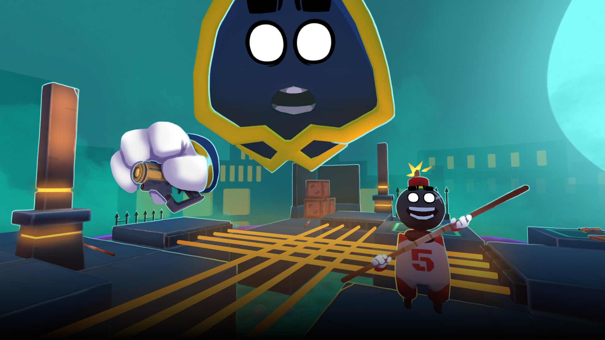

*crédit images : Squido Studio*

*(Mise à jour 22 mai 2024 : Anarchitects a changé de titre pour DigiGods. Il est [disponible dès maintenant sur Meta Quest.](https://www.meta.com/experiences/6859397944122034/))*

**Le studio montréalais [Squido Studio](https://www.squidostudio.com/), qui nous a précédemment donné No More Rainbows, annonce un nouveau jeu en VR/MR (réalité virtuelle et réalité mixte) qui sera en démonstration au [GDC (Game developers conference)](https://gdconf.com/?_mc=sem_gdcsf_sem_gdcsf_attnd_tspr_google_brndgbl_2024&utm_source=google&utm_medium=sem_&utm_campaign=brndgdc&utm_content=attnd_&gad_source=1&gclid=CjwKCAiArfauBhApEiwAeoB7qJt6VbYDlP-JSRHiMa-o6wq-dcz_Cf8Hi4E6qamyfAhTrXoG0RdebhoCLVEQAvD_BwE) du 18 au 22 mars prochain à San Francisco. DigiGods permettra notamment aux joueurs de créer leur propre jeu avec un système visuel intuitif.**

[No More Rainbows](https://store.steampowered.com/app/1634100/No_More_Rainbows/), l’effort précédent du studio, également un jeu en réalité virtuelle, a touché plus de 500 000 joueurs, atteignant le top 1 des jeux téléchargés sur le Quest Store. Il est d’ailleurs maintenant disponible sur Meta Quest, Steam, Pico, et bientôt sur PSVR 2.

https://www.youtube.com/watch?v=PsoPJtOpc3I

DigiGods est un jeu sandbox en VR/MR qui offre une plateforme innovante permettant aux joueurs de construire, jouer et partager leurs créations sans nécessiter de script ou de codage, grâce à un système de *drag-and-drop* intuitif. Squido Studio promet également une physique multijoueur en temps réel révolutionnaire.

Les joueurs seront libres de créer des expériences diverses telles que des puzzles complexes, un shooter d’équipe en gravité zéro ou même des jeux de société.

**[Surveillez le site web officiel du jeu](https://www.anarchitects.gg/) pour le dévoilement de la première bande-annonce le 15 mars prochain.**

**À LIRE AUSSI : [La semaine sherbrookoise du jeu vidéo : une 3e édition aura lieu en mars](/2024/02/17/la-semaine-sherbrookoise-du-jeu-video-une-3e-edition-aura-lieu-en-mars/)**

[**À LIRE SUR BÊTA-TESTEUR : Critique de Mario vs Donkey Kong**](https://www.lebetatesteur.ca/test-mario-vs-donkey-kong-est-de-retour/)
