*crédit images : Misstic Studio*

**[Sunrise’s Order](https://store.steampowered.com/app/1931990/Sunrises_Order/), le « cozy game » du studio sherbrookois [Misstic Studio](https://www.missticstudio.com/) sera officiellement disponible sur Steam le 22 mai 2024, et cela, après huit mois en accès anticipé.**

Les joueurs pourront donc mettre la main sur la version 1.0 du jeu ce printemps. **Sunrise’s Order** est un jeu de simulation de ferme où le joueur se retrouve seul sur son île et il devra utiliser un service de livraison pour subvenir à ses besoins et faire croître sa réputation.

https://www.youtube.com/watch?v=i4MfhSUQPXA

En attendant la sortie finale, vous pouvez tout de même vous lancer dans la version accès anticipé sur [Steam, ou le wishlister.](https://store.steampowered.com/app/1931990/Sunrises_Order/)

**Quelques captures d’écran du jeu :**

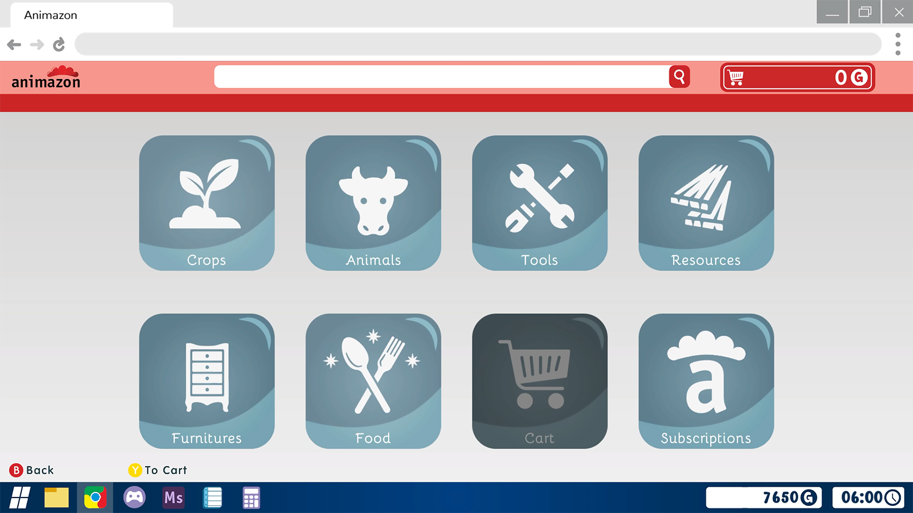

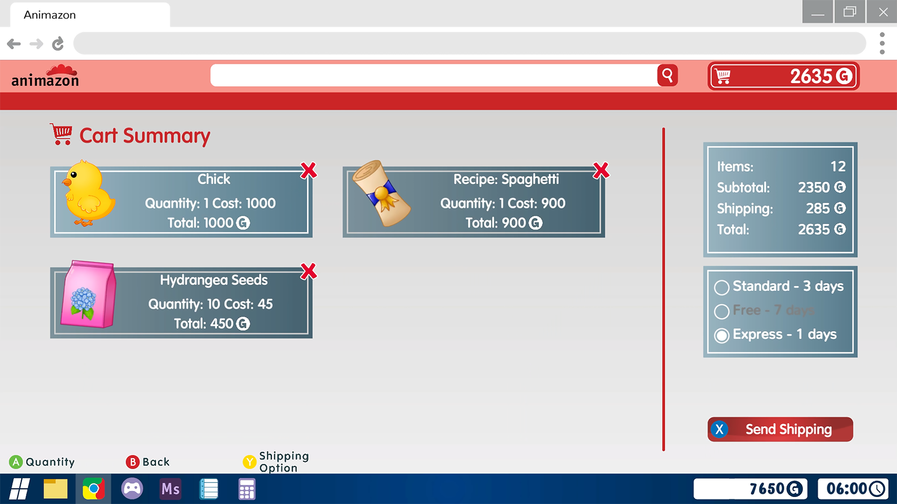

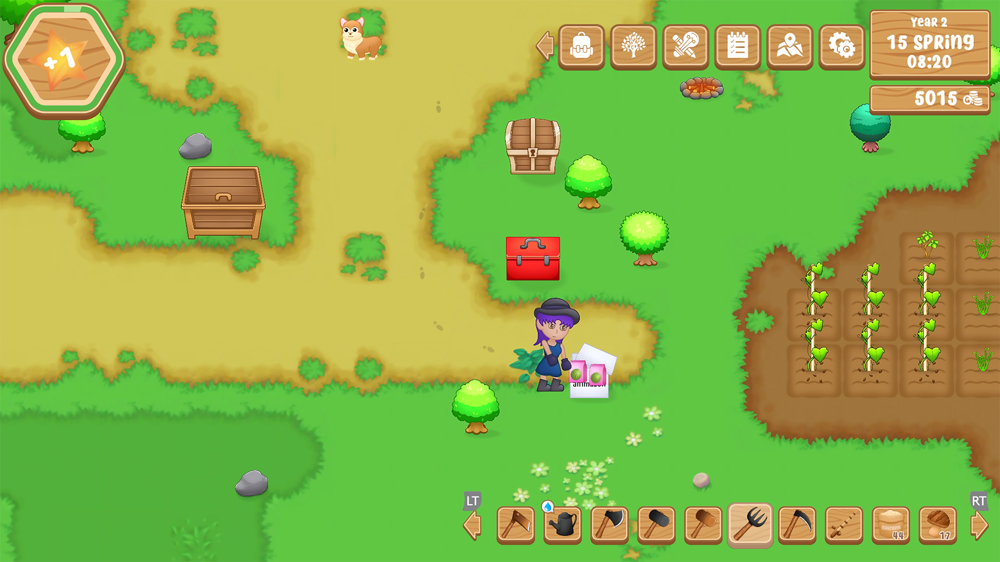

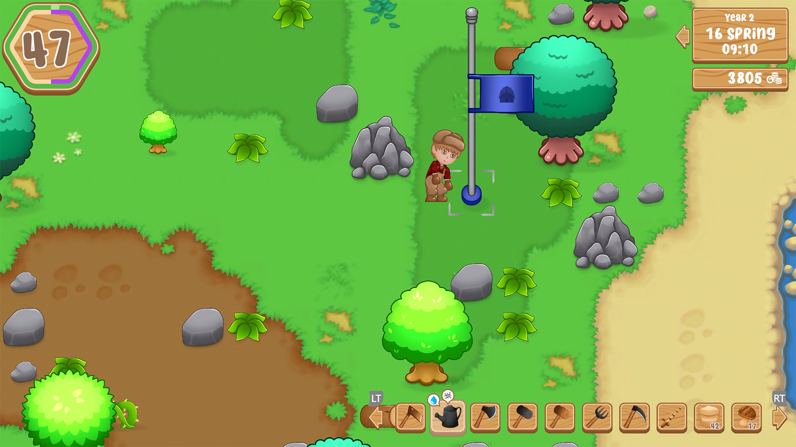

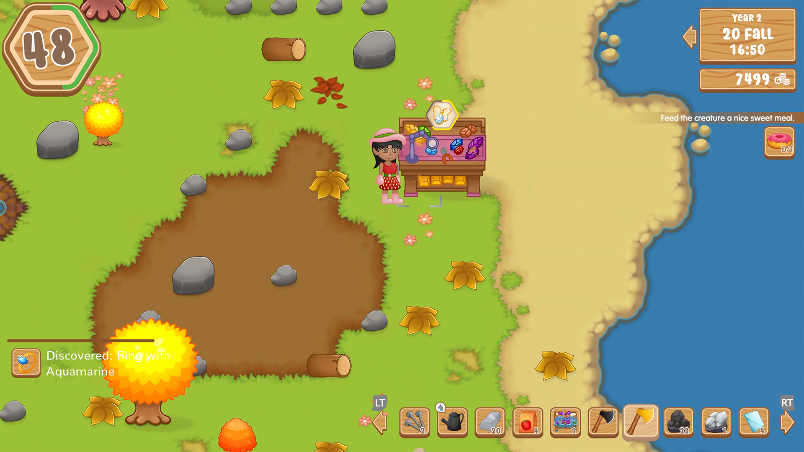

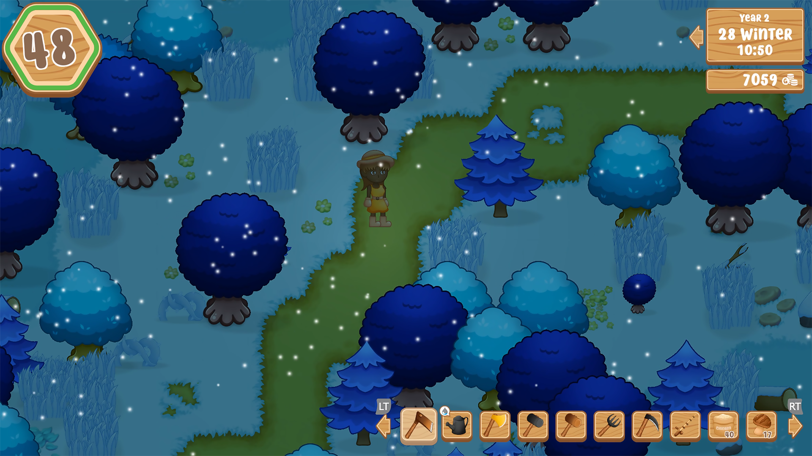

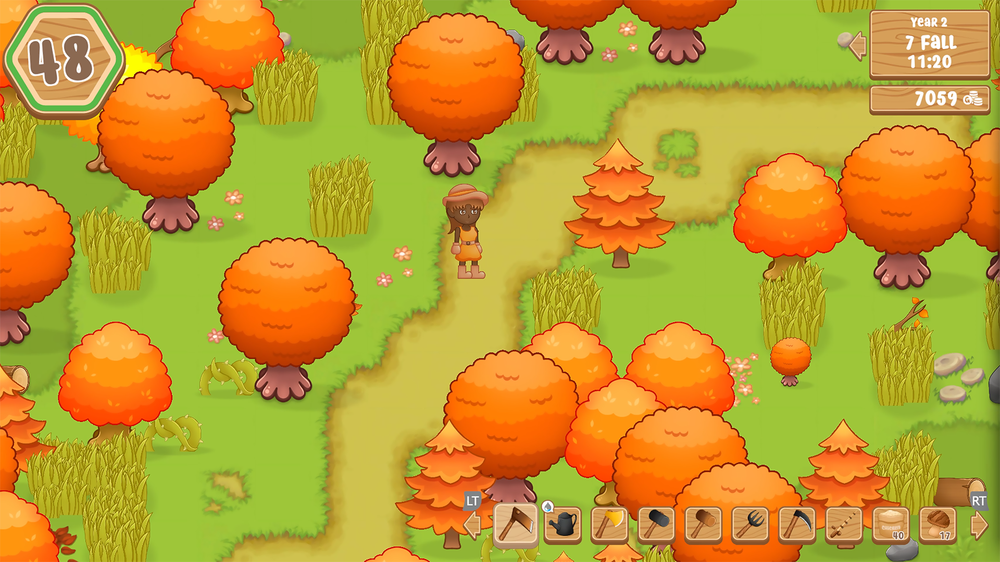

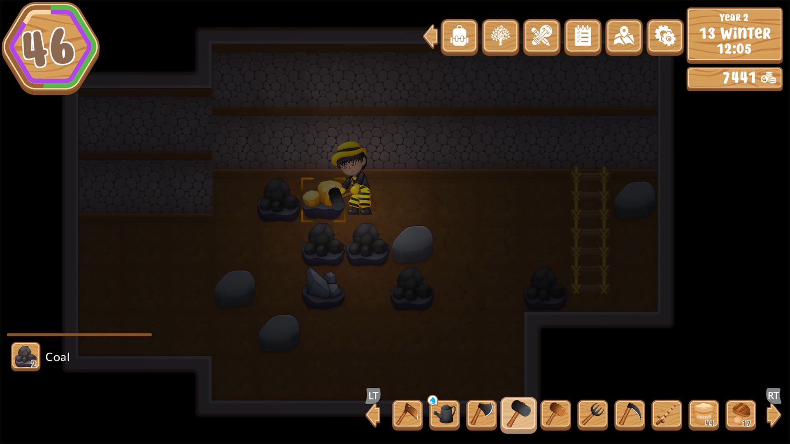

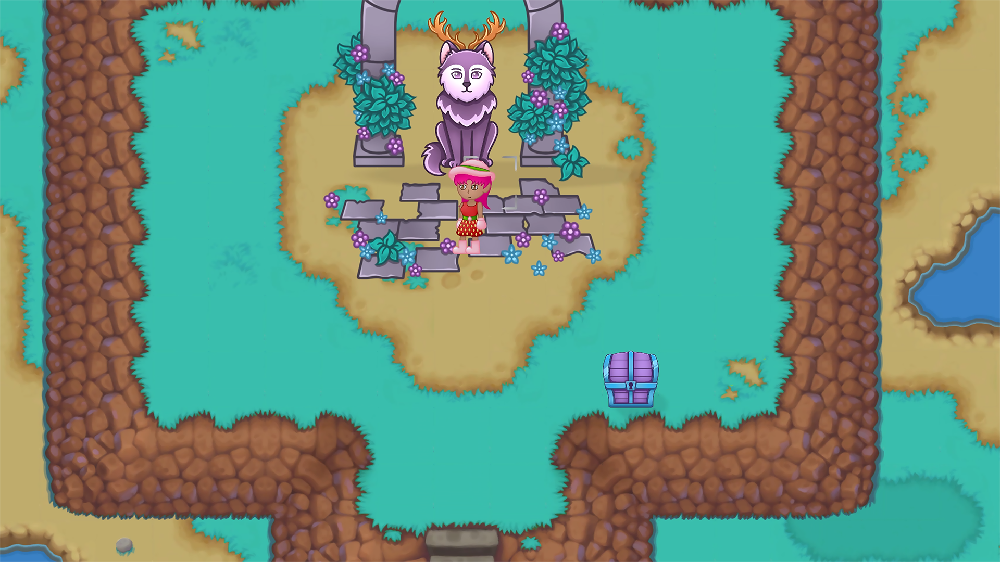

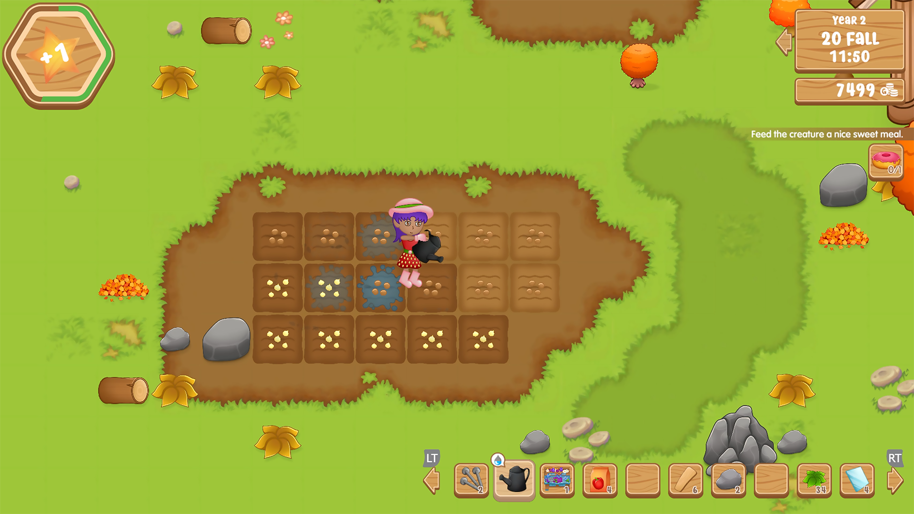

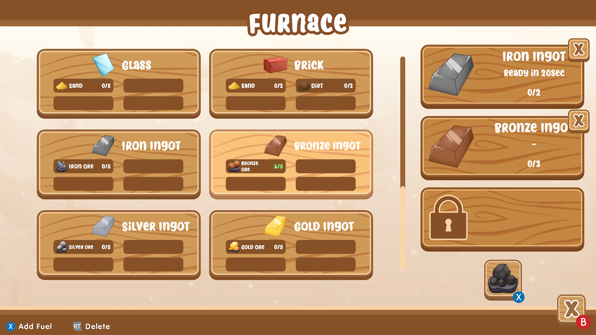

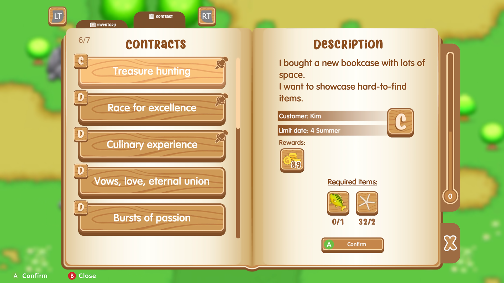

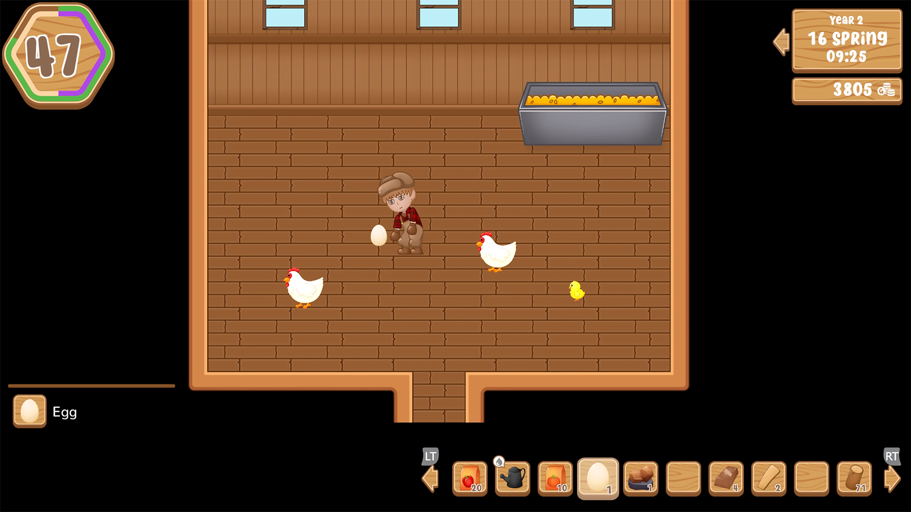

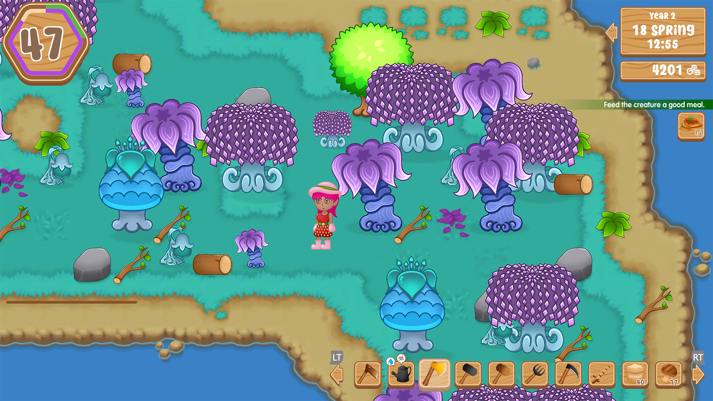

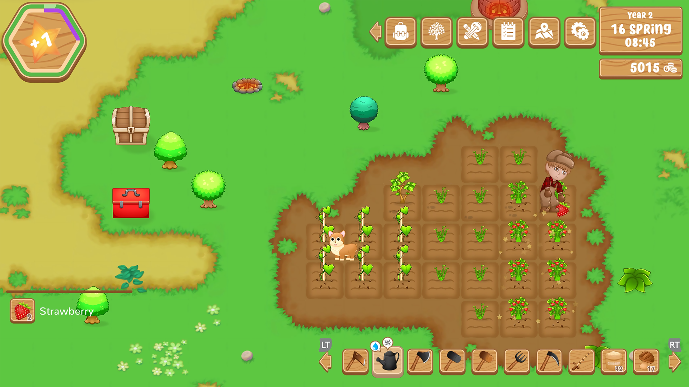

**À LIRE AUSSI : [Diversité et réalité autochtone : entrevue avec Alexis Gros-Louis Houle de Awastoki](/2024/04/20/diversite-et-realite-autochtone-entrevue-avec-alexis-gros-louis-houle-de-awastoki/)**
