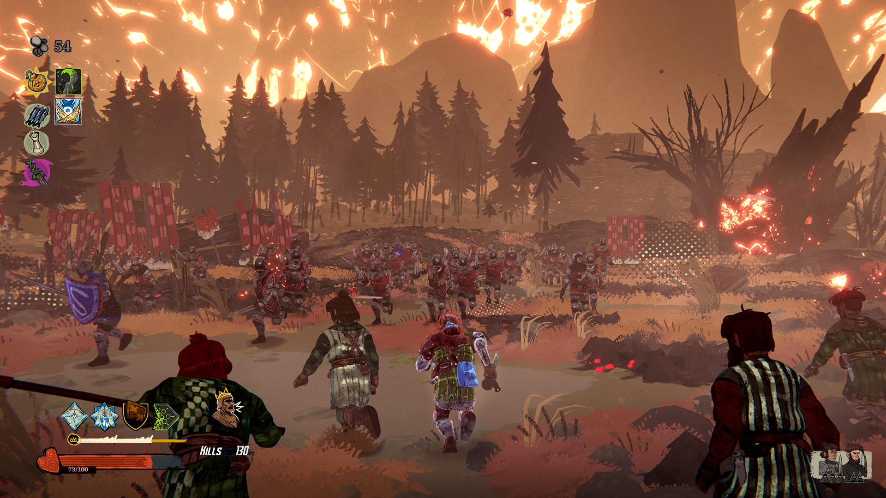

*images gracieuseté de Paper Cult*

**Le studio montréalais [Paper Cult](https://www.tearsofmetal.com/) vient de confirmer que son hack-and-slash roguelike *Tears of Metal* arrivera sur Xbox Series X|S, le Microsoft Store et le Game Pass, en plus de Steam. L’annonce a été faite lors de l’ID@Xbox Showcase, accompagnée d’une toute nouvelle bande-annonce. L’accès anticipé est toujours prévu pour le printemps 2026.**

https://www.youtube.com/watch?v=rc0QaV-POng

#### Reconquérir son île, un ennemi à la fois

*Tears of Metal* plonge le joueur dans un univers médiéval fantastique où un météore — le Dragon Stone — a déclenché une invasion ennemie et répandu de mystérieux pouvoirs sur l’île. À la tête d’un bataillon écossais, le joueur doit tailler son chemin à travers des hordes d’ennemis sur plus de 45 environnements façonnés à la main, seul ou en coopération avec ses amis.

Le jeu mise sur la profondeur de ses systèmes : des dizaines d’artefacts à combiner, des héros jouables aux styles distincts, une progression permanente pour ses soldats et un campement à développer entre les parties pour débloquer de nouvelles boutiques et améliorations. Chaque run génère des combinaisons uniques, typiques du genre roguelike.

La date précise de l’accès anticipé n’a pas encore été annoncée, mais l’équipe promet des nouvelles sous peu. En attendant, le jeu est déjà sur la liste de souhaits de [Steam](https://store.steampowered.com/).

---

📚 **À LIRE AUSSI :** [Nos articles sur les jeux roguelike](https://mariojramos8.wordpress.com/tag/roguelike/)
