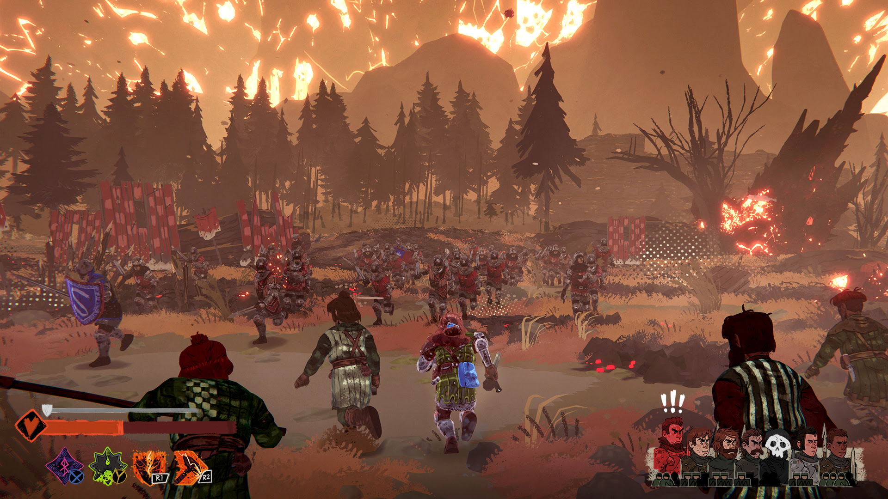

*images gracieuseté de Paper Cult Games*

**Le studio indépendant montréalais [Paper Cult](https://store.steampowered.com/publisher/PaperCult) a annoncé, dans le cadre de l’initiative Triple-I, le lancement d’une bêta ouverte à durée limitée (du 10 au 17 avril) pour son jeu très attendu, [*Tears of Metal*, sur Steam](https://store.steampowered.com/app/1913120/Tears_of_Metal/). Cette démo exclusive offre aux joueurs un avant-goût palpitant de l’Acte I, où ils incarneront le personnage de départ dans une lutte acharnée contre le redoutable boss Gilles.**

https://www.youtube.com/watch?v=PLr5k1FKGAw

Une fois ce défi relevé, les joueurs auront accès à une boutique spéciale mettant à l’épreuve leur « métal », seul ou avec un maximum de trois amis. *Tears of Metal* promet une expérience intense de hack-and-slash médiéval avec des éléments roguelike, où la coopération sera la clé de la survie.

Dans *Tears of Metal*, les joueurs devront tailler leur chemin à travers des hordes d’ennemis pour reconquérir leur île avec l’aide d’un valeureux bataillon écossais. Au fil de leur progression dans les tranchées, ils découvriront les secrets du mystérieux météore draconique et de l’invasion ennemie perfide. Le jeu propose de vastes champs de bataille, des défis constants et la possibilité de combiner des améliorations puissantes et plus d’une centaine d’artefacts pour créer des builds uniques et dévastateurs.

Les joueurs pourront choisir parmi plusieurs héros jouables et recruter des soldats écossais, qu’ils pourront améliorer de manière permanente entre les campagnes.

Entre les missions, l’expansion du campement permettra de débloquer de nouvelles boutiques, des améliorations permanentes et des défis encore plus corsés pour des récompenses accrues.

Que vous préfériez l’aventure en solo ou la coopération avec vos amis, *Tears of Metal* offrira plus de 45 environnements artisanaux et une rejouabilité infinie grâce à des scénarios et des objectifs uniques.

La sortie officielle de [*Tears of Metal* sur Steam](https://store.steampowered.com/app/1913120/Tears_of_Metal/) est prévue pour plus tard cette année.

Pour plus d’informations, vous pouvez visiter le site officiel : [https://www.tearsofmetal.com/](https://www.tearsofmetal.com/).

**À LIRE AUSSI : [Ressources inhumaines : un thriller littéraire intéractif](/2025/04/12/ressources-inhumaines-un-thriller-litteraire-interactif/)**
