*Copie du jeu et images gracieuseté de Amenti Studio*

**Développé par [Amenti Studio](https://amentistudio.com/), *The Book of Aaru* s’impose d’entrée de jeu comme une belle surprise du paysage vidéoludique indépendant. Alliant des mécaniques classiques d’action-RPG avec des éléments de *roguelite*, ce jeu propose une aventure dense, aride et envoûtante, qui rappelle à la fois *Path of Exile*… et un rêve fiévreux dans l’Égypte antique.**

#### **Un gameplay tranchant, fluide et destructible**

Dès le tutoriel, *The Book of Aaru* nous invite à forger notre style de jeu à travers un choix d’armes intrigant. Entre une lance polyvalente aux deux sorts, une épée courte couplée à un shakram étoilé, le joueur est poussé à expérimenter. Le shakram, dans notre cas, a offert une belle alternative à notre habitude des sorts magiques, tout en conservant une sensation aérienne et dynamique au combat.

L’une des premières satisfactions vient de la capacité à **détruire une partie du décor**. Voir les colonnes se fissurer ou des statues s’effondrer sous l’impact de nos attaques procure une sensation de puissance immédiate. On est dans un monde vivant, où chaque coup laisse sa marque.

Le jeu propose une **vue isométrique** familière qui évoque directement *Path of Exile*, mais dans une version sablonneuse, baignée de lumière dorée et de poussière millénaire. Et contrairement à de nombreux jeux du genre, *The Book of Aaru* offre **un système de blocage bienvenu**, évitant ainsi les roulades incessantes et encourageant une approche plus stratégique.

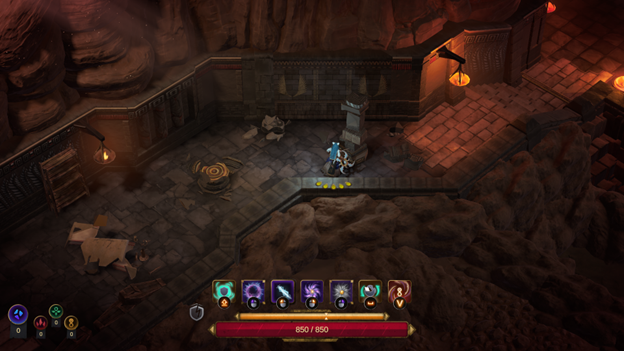

#### **Un monde ensablé, chargé d’ambiance**

L’ambiance sonore, sombre et granuleuse, est une réussite en soi. Des notes **grunge désertiques**, mêlant guitares électriques et percussions sourdes, accentuent le sentiment d’isolement et de tension qui règne dans les temples anciens. Une trame sonore qui semble chanter la mélancolie du sable et la fureur des dieux oubliés, avec une pointe de science-fiction (notable autant dans le son que dans des éléments un peu plus techno-futuristes dans les décors du jeu).

Le jeu nous fait évoluer à travers des **temples labyrinthiques**, aux pièges perfides et à l’architecture monumentale. Les effets de lumière et la direction artistique contribuent à renforcer ce sentiment de traverser un temple délabrés ou se cache trésors et entités maléfiques.

#### **Progression et personnalisation : Beetles et Glyphes**

Votre progression dépend de ce que vous saurez récupérer et utiliser intelligemment. En explorant, on met la main sur des **Beetle Shards**, trouvés dans des cages dorées. Ceux-ci peuvent être convertis en **Beetle Shells**, utilisables pour améliorer l’un des trois attributs clés :

- **Furious** : pour plus de dégâts.
- **Protectful** : pour augmenter vos points de vie.
- **Eonous** : pour maîtriser l’essence du Temps.

Les **Glyphes**, quant à eux, offrent une autre couche de personnalisation. Trouvables dans des coffres ornés de hiéroglyphes, ils procurent des bonus passifs. Un glyphe tel que *Fortunate Bargain*, par exemple, réduit le coût d’activation d’une capacité temporelle. Et tout indique qu’on peut **améliorer l’efficacité des glyphes** plus loin dans le jeu.

#### **Crafting, médaillons et destruction massive**

On découvre ensuite les **Crafting Schematics**, cachés dans le Temple d’Osiris. Il en faut trois pour débloquer la possibilité de forger de nouveaux objets via le *Book of Aaru*, situé dans le **Bastion** – une salle centrale où l’on prépare ses aventures.

Le *crafting* permet de créer **armes, glyphes et médaillons**, ces derniers conférant des bonus lorsqu’on embrasse notre côté destructeur et **anéantit tout l’environnement**. Une approche jubilatoire du *loot* et de la construction d’équipement!

#### **Un challenge progressif mais impitoyable**

Si les premiers combats se prennent bien en main, la **difficulté monte rapidement**. Lors d’une épreuve de survie de 90 secondes à la fin du tutoriel, il devient évident que l’absence de soins en cours de mission (sauf précautions préalables) force le joueur à maîtriser esquives et blocages. Un faux sentiment de sécurité peut coûter cher face à un groupe d’ennemis coordonnés.

En plus, le jeu applique un système de **permadeath partiel** : à chaque mort, on perd les matériaux amassés… sauf si on avait pensé à en offrir un pourcentage en offrande, pour récupérer une part lors de notre chute.

#### **Des ennemis variés et stylisés**

Les adversaires croisés jusqu’à présent sont aussi variés que visuellement intéressants :

- **Mages squelettiques volants** aux sorts douloureux.
- **Scarabées** explosifs.
- **Créatures gluantes toxiques** évoquant un cousin sinistre de Jabba the Hutt en plus petit
- **Soldats à tête d’animaux**, façon Anubis, au combat rapproché avec armes (*melee*).
- **Maringouins mécaniques dorés**, rapides et agaçants.

Chaque type demande une réponse différente, et le mélange imprévisible rend chaque salle potentiellement mortelle.

---

#### **Verdict** 8/10

*The Book of Aaru* propose une formule à la fois classique et fraîche. Sa maîtrise esthétique, ses mécaniques de progression intéressantes et sa jouabilité nerveuse mais réfléchie en font un titre à surveiller de très près. Le fait qu’on puisse **façonner son aventure, son équipement et même le décor** en détruisant tout autour de soi apporte un vrai plaisir de jeu.

On attend de voir comment se développe la suite, mais pour l’instant, ce livre ancien mérite clairement d’être ouvert… et exploré jusqu’à la dernière page.

**Quelques captures d’écrans du jeu :**

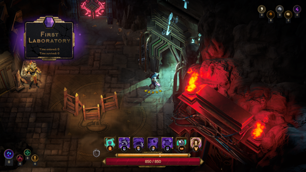

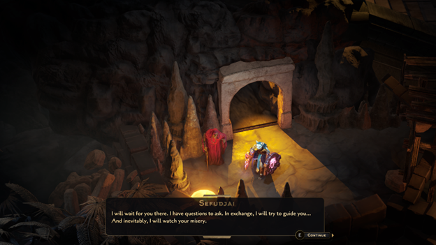

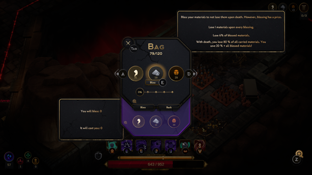

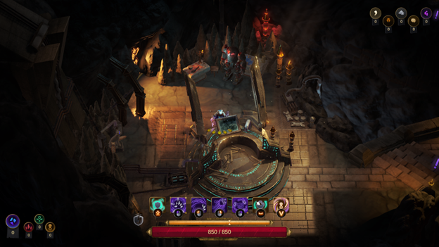

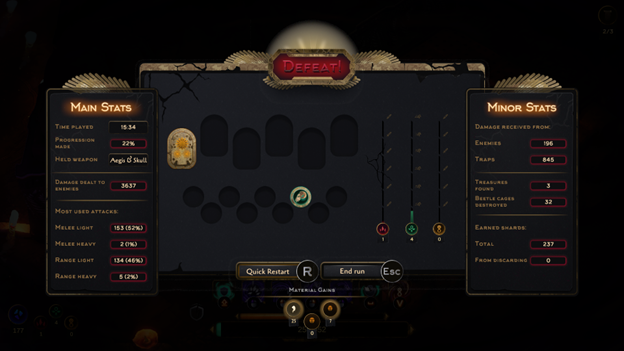

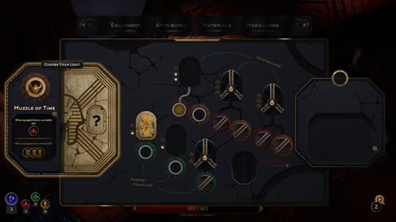

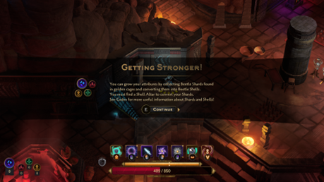

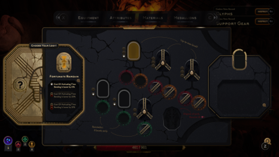

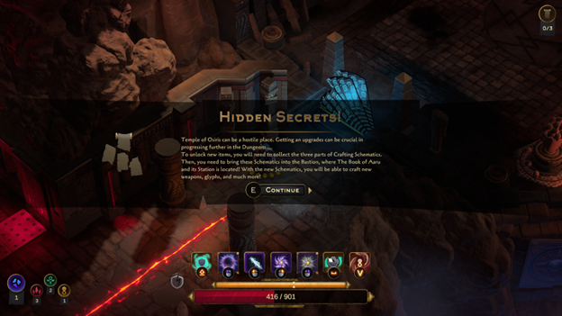

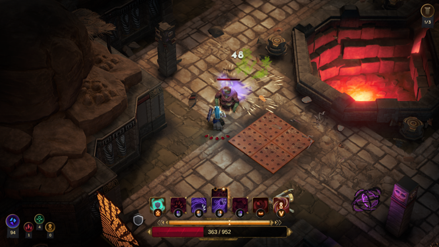

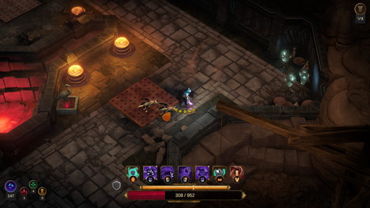

Ajoutez **The Book of Aaru** à votre [liste de souhaits Steam ici](https://store.steampowered.com/app/2092970/The_Book_of_Aaru/)

**À LIRE AUSSI : [Wu-Tang: Rise of the Deceiver – Le retour légendaire du Clan dans un RPG coopératif électrisant](/2025/06/20/wu-tang-rise-of-the-deceiver-le-retour-legendaire-du-clan-dans-un-rpg-cooperatif-electrisant/)**

*Disclosure: I received a free review copy of this product from [https://www.keymailer.co](https://www.keymailer.co)*
