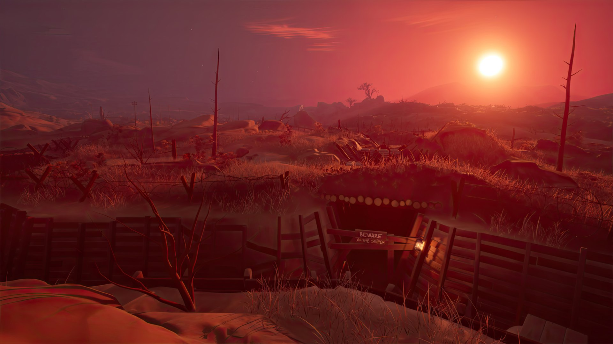
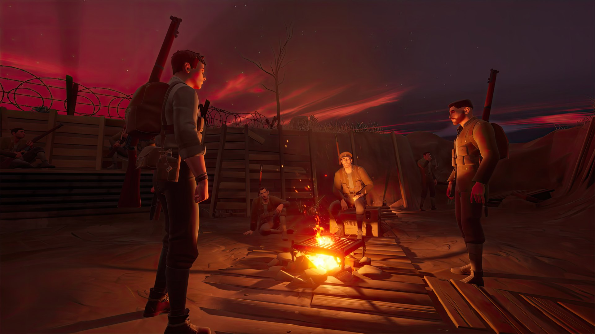

*images gracieuseté de Unreliable Narrators*

**[Unreliable Narrators](https://unreliablenarrators.ca/), le studio québécois derrière *[Two Falls (Nishu Takuatshina)](https://store.steampowered.com/app/1671740/Two_Falls_Nishu_Takuatshina/)*, confirme la date de sortie de son prochain jeu : *[The Caribou Trail](https://store.steampowered.com/app/3065030/The_Caribou_Trail/)* arrivera le **14 mai 2026** sur PC (Steam et Epic Games Store) et PlayStation 5. Le jeu a été dévoilé lors du Galaxies Gaming Showcase avec une nouvelle bande-annonce et un aperçu plus profond de son propos émotionnel.**

https://www.youtube.com/watch?v=z_9Ko3CitLY

## Une page d’histoire canadienne peu connue

Le jeu met en scène Fisher, un jeune canadien de Terre-Neuve qui s’enrôle dans le **[Royal Newfoundland Regiment](https://en.wikipedia.org/wiki/Royal_Newfoundland_Regiment)** et se retrouve projeté dans [la campagne de Gallipoli en 1915](https://veterans.gc.ca/fr/commemoration/histoire-militaire/premiere-guerre-mondiale/campagne-de-gallipoli), l’une des batailles les plus désastreuses et les moins documentées de la Grande Guerre. Plus de 1 000 Terre-Neuviens ont débarqué à Suvla Bay le 30 septembre 1915, et c’est là qu’ils ont pris ce qui allait devenir connu sous le nom de *Caribou Hill*, au prix de lourdes pertes.

Ce qui rend ce régiment particulièrement fascinant : à l’époque, Terre-Neuve n’était pas encore une province canadienne. Ce n’est qu’en 1949 que le Dominion de Terre-Neuve a rejoint la Confédération — ce qui en fait une communauté de pêcheurs isolée, animée d’un fort désir de se faire reconnaître sur la scène internationale.

Une démo gratuite est dès maintenant disponible sur [Steam](https://store.steampowered.com/) pour ceux qui veulent goûter à l’atmosphère avant la sortie du 14 mai.

---

📚 **À LIRE AUSSI :** [Incarnez un goéland déjanté dans ce jeu d’un développeur solo](https://mariojramos8.wordpress.com/2025/09/27/incarnez-un-goeland-dejante-dans-ce-jeu-dun-developpeur-solo/)
