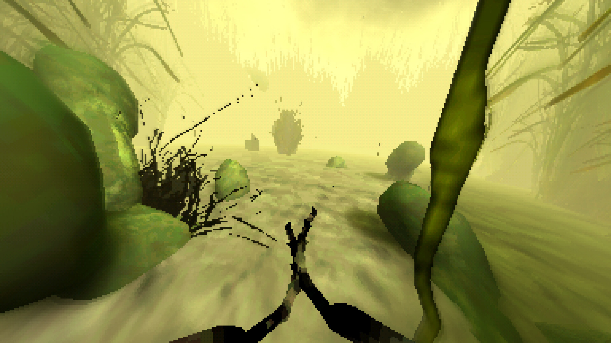
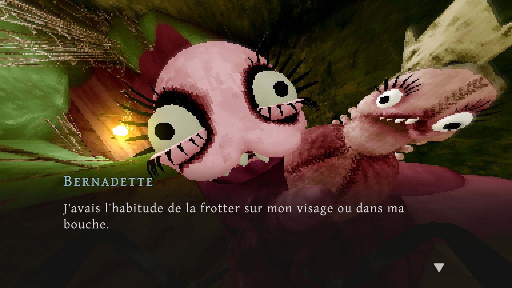
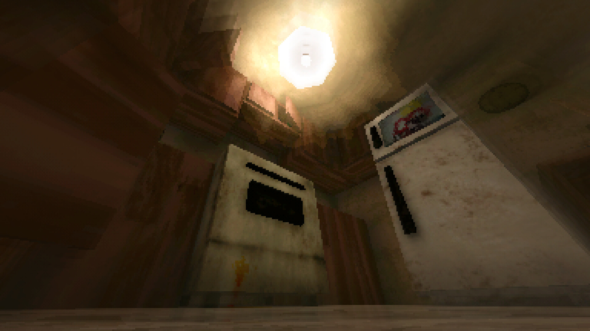

*copie du jeu et images gracieuseté de Erupting Avocado*

**Dans la lignée du mouvement [HauntedPS1](https://hauntedps1.itch.io/), qui célèbre l’esthétique des premiers jeux d’horreur en 3D, le studio québécois [Erupting Avocado](https://eruptingavocado.com/) nous livre une expérience singulière avec [The Hungry Fly](https://store.steampowered.com/app/2107180/The_Hungry_Fly/). Ce jeu narratif d’horreur nous place dans la peau d’une mouche en quête de cadavres à dévorer – une prémisse qui s’avère rapidement être bien plus symbolique que littérale.**

Ce qui commence comme une quête macabre se transforme en une exploration onirique chargée de symboles et de sens cachés.

On incarne bel et bien une mouche dans un marais où on rencontre plusieurs personnages singuliers, notamment des chenilles, dont Jean-Arnold, fasciné par un yo-yo, et Bernadette, qui cherche désespérement la brosse de sa poupée. On rencontre également une plante qui en nous avalant nous transporte dans un appartement où on pourra dévorer des objets liés aux souvenirs d’un monstre. J’aimerais vous expliquer davantage, mais l’idée est de découvrir cet univers étrange par soi-même.

Les mécaniques sont simples; on peut voler avec des contrôles simples à maîtriser, parler aux différents personnages qu’on rencontre et manger, essentiellement. C’est un jeu qui s’adresse principalement aux amateurs de jeux narratifs et expériences narratives plus expérimentales ou abstraites.

La courte durée du jeu, qui est d’environ une heure, encourage la rejouabilité à travers ses multiples fins possibles, invitant les joueurs à explorer différentes approches et à découvrir de nouvelles couches de sens à chaque partie.

L’esthétique rétro, caractéristique du mouvement HauntedPS1, est ici parfaitement maîtrisée. Les environnements 3D, délibérément datés, ne sont pas qu’un simple exercice de style nostalgique. Ils participent activement à la création d’une atmosphère oppressante et dérangeante. Les limitations techniques apparentes deviennent des atouts, contribuant à l’étrangeté générale de l’expérience et renforçant le sentiment d’aliénation.

The Hungry Fly réussit le pari audacieux de transformer une prémisse à priori rebutante en une expérience artistique fascinante. Sa courte durée est compensée par une excellente rejouabilité, et son esthétique rétro sert parfaitement ses ambitions narratives.

## Verdict : 8/10

**À LIRE AUSSI : [Unknown 9 : Awakening – un monde fascinant à découvrir](/2024/12/07/unknown-9-awakening-un-monde-fascinant-a-decouvrir/)**
