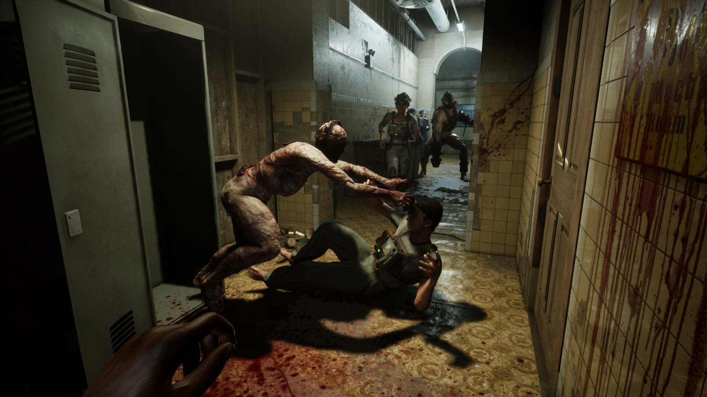

*Crédit images : Red Barrels*

## Après les titres à succès Outlast et Outlast II, [Red Barrels](https://redbarrelsgames.com/) a récidivé avec The Outlast Trials dont la proposition est assez différente, misant sur une expérience multijoueur. Après plus d’un million de copies vendues, The Outlast Trials va se pointer le bout du nez sur consoles en début 2024.

Red Barrels annonce donc The Outlast Trials sur PlayStation 5 et Xbox Series X/S pour début 2024, et oui, le but est de permettre le crossplay et matchmaking entre consoles et PC.

## Une mise à jour pour l’Halloween

Red Barrels va bien entendu profiter de l’Halloween pour une mise à jour d’envergure. Un nouveau trial, de nouveaux MK-Challenges, ainsi qu’un programme dont la disponibilité sera limitée pendant la période d’Halloween, avec des récompenses uniques. Il y a aura également de nouveaux items de décorations et des corrections de *qualité de vie* pour les joueurs, entre autres.

Les changements sont détaillés de façon exaustive [sur le blogue de Red Barrels.](https://store.steampowered.com/news/app/1304930/view/3680057643254190574)

https://www.youtube.com/watch?v=DuKkethkMeo

**À LIRE AUSSI : [33 Immortals : plus de détails sur le nouveau jeu de Thunder Lotus](/2023/08/25/33-immortals-plus-de-details-sur-le-nouveau-jeu-de-thunder-lotus/)**
