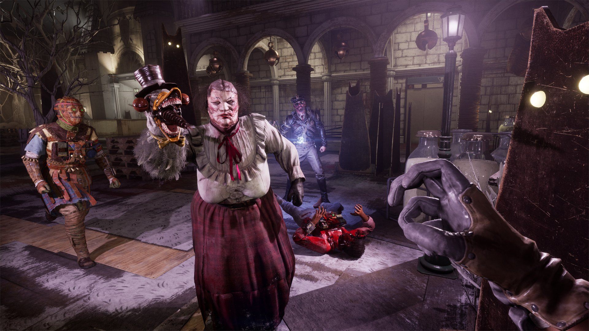
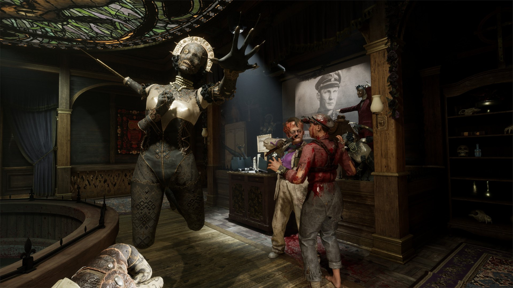
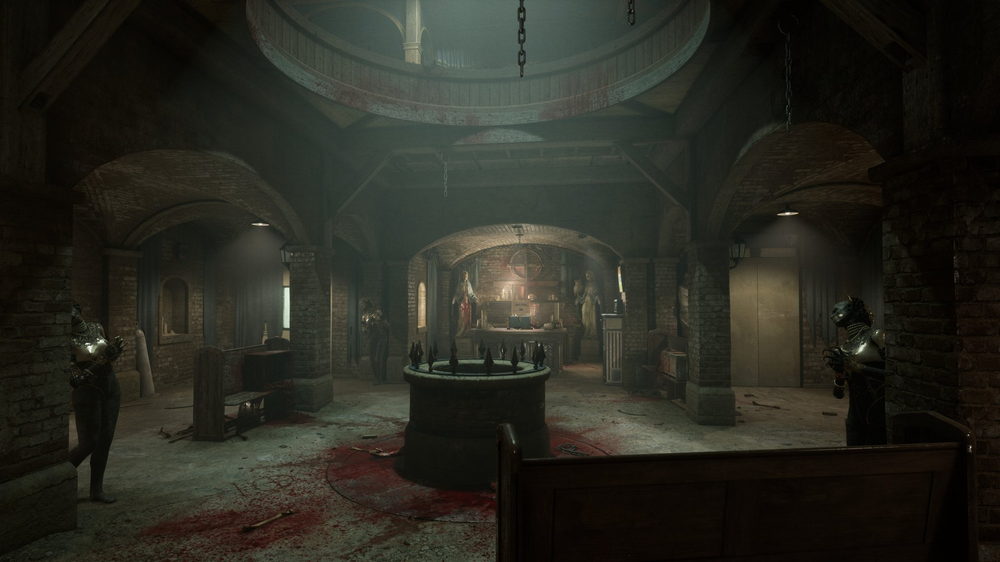
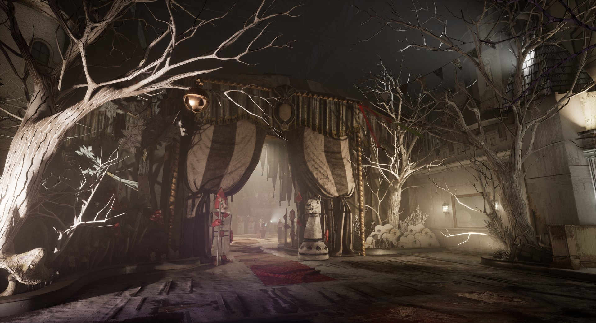
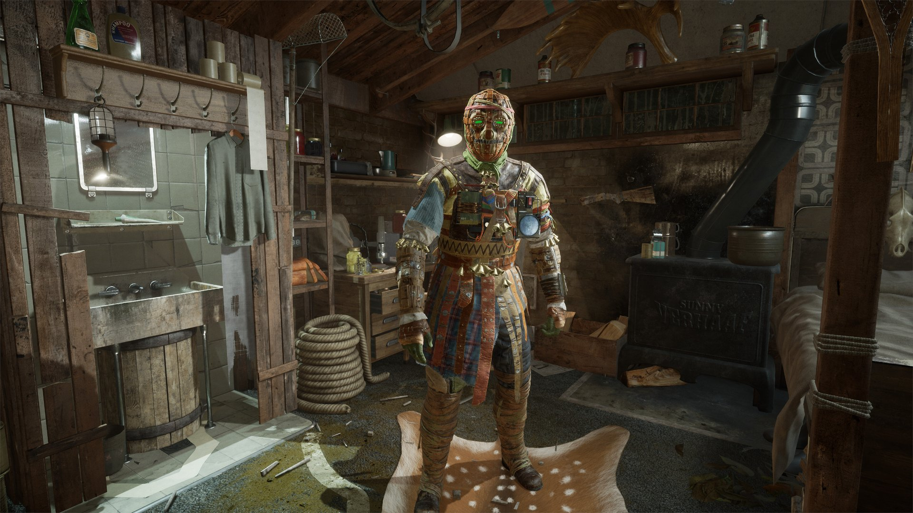

*images gracieuseté de Red Barrels*

**Le studio montréalais [Red Barrels](https://redbarrelsgames.com/) a lancé la mise à jour Season 6.1 : Prime Time pour [The Outlast Trials](https://store.steampowered.com/app/1304930/The_Outlast_Trials/). Dans la foulée de la Saison 6 : Project Judas — qui avait introduit le Television Studio et l’idôle politique Bob Vanier —, cette nouvelle mise à jour tourne le bouton encore plus loin vers l’horreur, le contrôle et la paranoïa.**

https://www.youtube.com/watch?v=DjTNfynv4-E

## La Prime Roulette : plusieurs bourreaux, une seule partie

La nouveauté centrale de cette mise à jour est la **Prime Roulette** : durant l’événement à durée limitée Prime Time, plusieurs Prime Assets peuvent désormais envahir la même partie de façon rotative et imprévisible. Les joueurs devront également détruire des téléviseurs défectueux pour obtenir des récompenses supplémentaires et débloquer de nouveaux cosmétiques exclusifs à l’événement.

Deux nouveaux défis MK accompagnent la mise à jour : **Win the Truth** et **Incinerate the Relic**, chacun conçu pour pousser la foi, l’obéissance et l’instinct de survie des joueurs à leurs limites sous les projecteurs de Murkoff.

## Nouvelles thérapies de routine à venir

Red Barrels annonce deux prochaines thérapies de routine, dont la durée est étendue à deux semaines chacune suite aux demandes de la communauté :

- **CLASSIFIED** — Des variateurs secrets ont été ajoutés. Adapter ou mourir. (16 au 30 juin)
- **MIRROR** — La perspective du Trial est altérée pour dérouter les réactifs. (30 juin au 14 juillet)

---

📚 **À LIRE AUSSI :** [Red Barrels lance Project Judas et célèbre 15 ans d’horreur montréalaise](https://mariojramos8.wordpress.com/2026/04/10/red-barrels-lance-project-judas-et-celebre-15-ans-dhorreur-montrealaise/)
