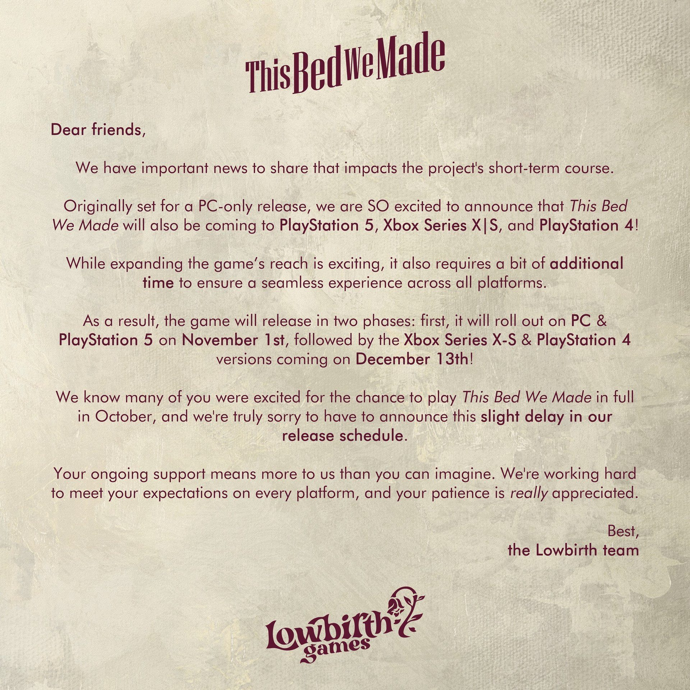

*Crédit images : Lowbirth Games*

**[This Bed we Made](/2023/09/03/this-bed-we-made-une-nouvelle-bande-annonce-et-une-date-de-lancement/), jeu d’aventure et d’enquête originalement prévu pour octobre, verra sa sortie reportée de quelques semaines. C’est cependant une bonne nouvelle : c’est pour donner un peu plus de temps aux développeurs de préparer la version console, nouvellement annoncée.**

C’est via un message sur ses réseaux sociaux que le développeur québécois [Lowbirth Games](https://lowbirthgames.com/) a fait la double-annonce:

This Bed we made sera disponible sur PC et PlayStation 5 le 1er novembre 2023, et sur Xbox Series et PlayStation 4 le 13 décembre 2023.

Pour l’occasion, on a également eu droit à une nouvelle bande-annonce :

https://www.youtube.com/watch?v=POW45X2wsvo

**À LIRE AUSSI : [6 jeux vidéo québécois parfaits pour l’Halloween](/2023/09/25/6-jeux-video-quebecois-parfaits-pour-lhalloween/)**

**À LIRE SUR BÊTA-TESTEUR : [Critique de Disgae 7](https://www.lebetatesteur.ca/test-disgaea-7-vows-of-the-virtueless-arrive-enfin/)**
