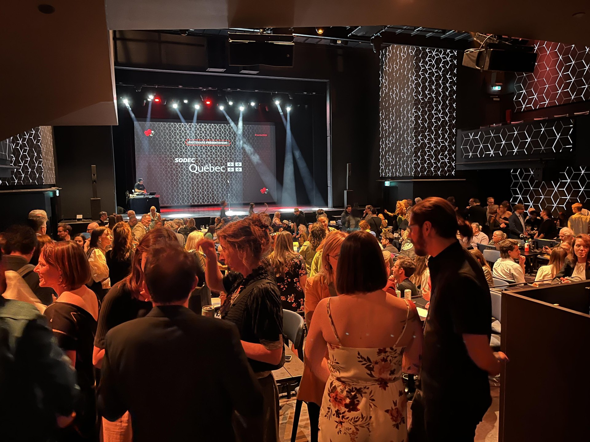
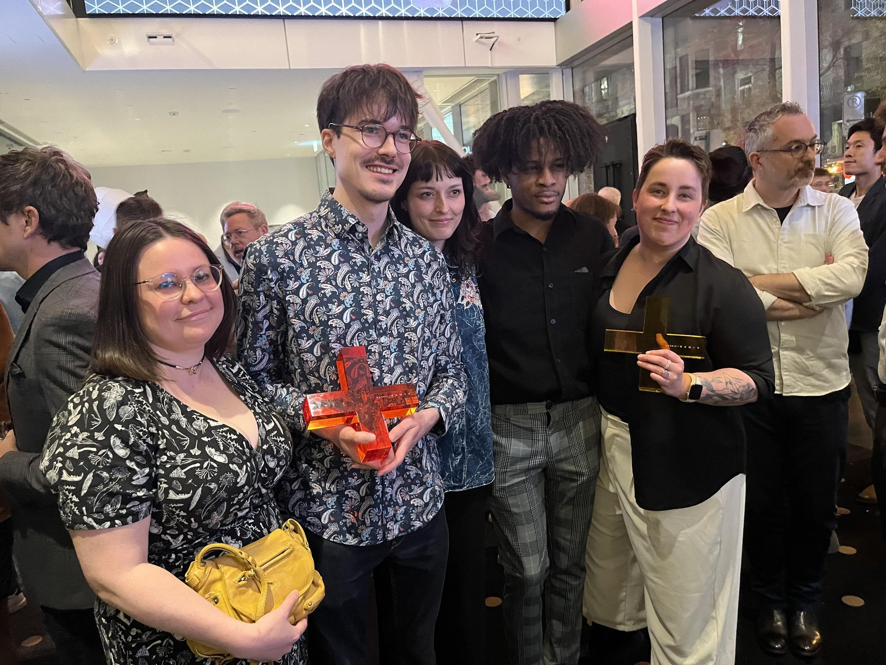

**C’est hier que se déroulait à l’Espace Saint-Denis à Montréal le Gala des [Prix Numix](https://numix.ca/), qui depuis maintenant 15 ans, met ses phares sur le vaste monde de la création numérique québécoise, de la websérie à la balado, en passant par le jeu vidéo et l’installation numérique en présentiel. Il s’agit d’une initiative de la compagnie [Xn Québec.](https://www.xnquebec.co/)**

Dans la catégorie jeu vidéo indépendant, c’est le studio montréalais [Lowbirth Games](https://lowbirthgames.com/) qui est reparti avec le petit trophé sous forme de X rouge pour son premier jeu This bed we made.

*En toute transparence, j’étais [un des membres du jury](https://numix.ca/membres-jury2024/mario-j-ramos/) dans la catégorie jeu vidéo indépendant.*

Trois jeux vidéo étaient en lice dans cette catégorie :

- **[No More Rainbows](https://store.steampowered.com/app/1634100/No_More_Rainbows/)** – jeu de plateformes à la 1ère personne en réalité virtuelle de [Squido Studio](https://www.squidostudio.com/).
- **[This bed we made](https://store.steampowered.com/app/1243850/This_Bed_We_Made/)** – jeu d’aventure narratif mettant en vedette une femme de ménage dans un hôtel montréalais des années 50, de Lowbirth Games.
- **[La vallée qui murmure](https://store.steampowered.com/app/1512390/The_Whispering_Valley__La_valle_qui_murmure/?l=french)** – jeu d’horreur pointer-et-cliquer se déroulant dans un sinistre village québécois au 19e siècle, du [studio Chien d’Or.](https://www.studiochiendor.com/)

C’est donc This bed we made qui a gagné, pour la sensibilité avec laquelle ses thèmes LGBTQ sont abordés ainsi que pour sa direction artistique cinématographique, entre autres.

Olivier Lussier, directeur créatif chez Lowbirth Games, a livré un discours qui souligne l’importance du jeu vidéo en tant que vecteur d’un discours socio-politique; en voici un extrait :

> « *En jeu vidéo, on se fait souvent dire « keep politics out of video games » (gardez la politique hors des jeux vidéo.) En ce moment, je regarde le génocide en Palestine, je regarde les États-Unis qui veulent faire reculer 60 ans en arrière par rapport aux droits à l’avortement et à la contraception, je regarde les luttes que mènent les personnes trans pour que leurs droits soient respectés… Je regarde tout ça et je me dis que plus que jamais on a besoin de films, de séries, de jeux, de balados à portée sociale.* »
>
> **– Olivier Lussier, co-fondateur et directeur créatif chez Lowbirth Games**

Surprise, This bed we made a également remporté **le Grand Prix** qui prenait en considération toutes les catégories récompensées au cours du gala.

**De gauche à droite : Margot Blanchard, lead designer, Olivier Lussier, co-fondateur et directeur créatif, Raphaelle Lussier, co-fondatrice et directrice artistique, Dougy Hérard, concepteur de jeu, Laurent Verret, lead 3D animateur.**

La liste de tous les nommés et lauréats des Prix Numix 2024 [est disponible ici.](https://numix.ca/palmares-2024/?utm_source=Numix+%7C+Envois+g%C3%A9n%C3%A9raux&utm_campaign=0d6dc3446a-EMAIL_CAMPAIGN_2018_11_28_08_50_COPY_01&utm_medium=email&utm_term=0_f9c80509b9-0d6dc3446a-416979409)

This bed we made est disponible sur [Steam](https://store.steampowered.com/app/1243850/This_Bed_We_Made/), [PlayStation 5](https://store.playstation.com/en-ca/product/UP7666-CUSA44603_00-0300014831910934) et [Xbox Series.](https://www.xbox.com/en-US/games/store/this-bed-we-made/9MXJSVP2NW44)

**À LIRE AUSSI : [Ubisoft Québec dévoile Assassin’s Creed Shadows](/2024/05/15/ubisoft-quebec-devoile-assassins-creed-shadows/)**
