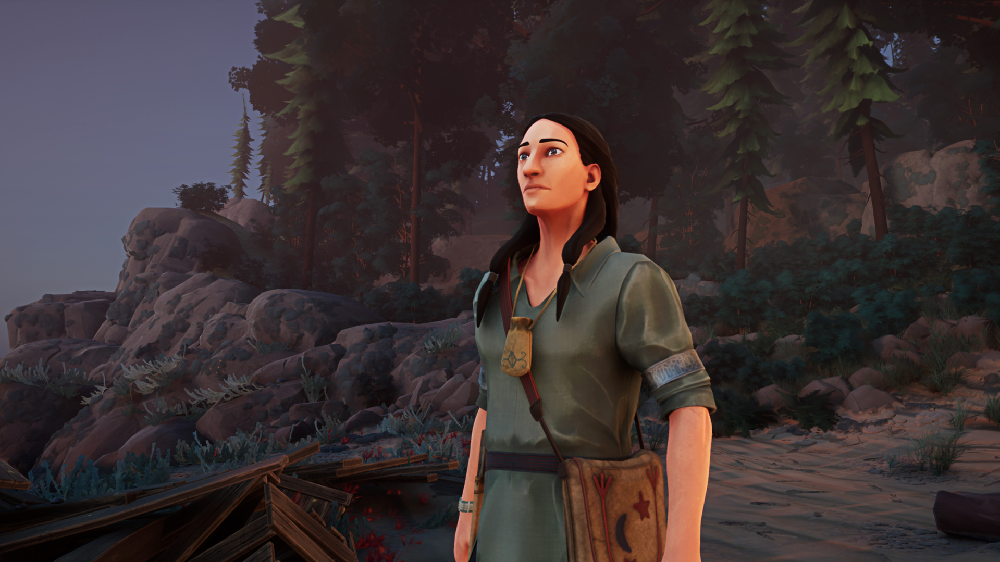
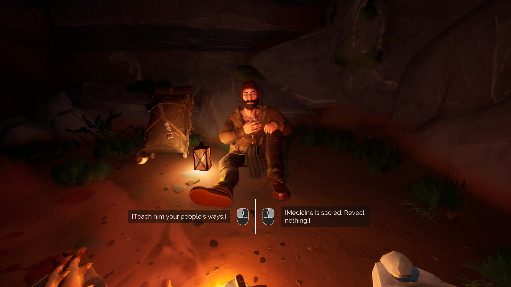
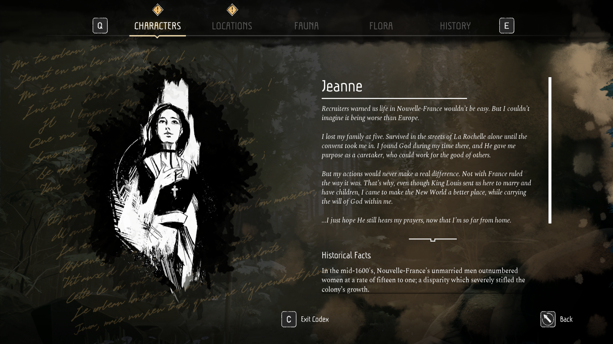
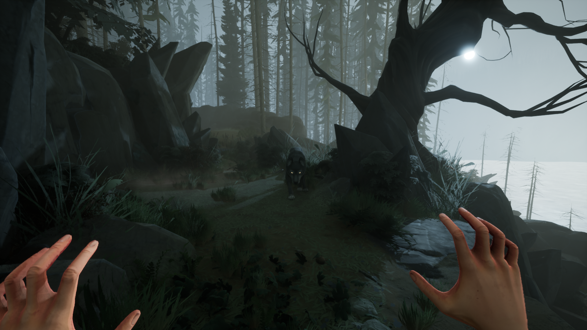

*images et copie du jeu gracieuseté de l’Indie Asylum*

**[Two Falls : Nishu Takuatshina](https://store.steampowered.com/app/1671740/Two_Falls_Nishu_Takuatshina/), développé par [Unreliable Narrators](https://two-falls.com/) en partenariat avec [l’Indie Asylum](https://www.indieasylum.com/), nous plonge dans une aventure narrative au cœur de la Nouvelle-France du 17e siècle. Le jeu propose une expérience unique en nous faisant incarner deux protagonistes aux perspectives radicalement différentes : Jeanne, une Fille du Roy fraîchement débarquée de France, et Maikan, un chasseur Innu.**

https://videopress.com/v/LcsOK9HD

S’inscrivant dans la tradition des « simulateurs de marche » – terme utilisé ici sans connotation péjorative – Two Falls privilégie la narration à l’action. Si l’interactivité reste limitée, le jeu compense par la richesse de ses dialogues à choix multiples qui permettent aux joueurs d’influencer le déroulement de l’histoire.

###### Une page d’histoire méconnue

Le jeu brille par son traitement nuancé d’une période historique souvent négligée dans l’enseignement scolaire au primaire et secondaire. La représentation des perspectives autochtones est particulièrement réussie, montrant la complexité des relations entre les différentes nations et les colons européens. Le jeu met notamment l’accent sur les réalités distinctes des Wendat et des Innus, entre autres.

Two Falls excelle dans sa galerie de personnages qui incarnent les multiples facettes de cette période historique. Pierre et les autres coureurs de bois : un métier dangereux dans une nature remplie de dangers fatals. Jeanne : la colonisatrice Fille du Roy nouvellement arrivée dont la foi chrétienne sera bousculée. Waikan : le chasseur Innu dégoûté devant les pratiques colonisatrices destructrices des colons français. Tehon : l’interprète Wendat tiraillé entre deux mondes. Le Père Augustin : le missionnaire Jésuite prêt à tout pour propager la foi de son dieu.

L’authenticité du récit est renforcée par l’implication directe de créateurs autochtones dans l’équipe de développement. L’ensemble de la narration a été développée en étroite collaboration avec un conseil d’aînés autochtones, assurant ainsi une représentation respectueuse et fidèle des cultures et perspectives des Premières Nations. Aussi, le studio de services 3D, [Awastoki](https://awastoki.com/), situé dans une communauté Wendat, a participé au développement visuel du jeu.

Au fur et à mesure que le joueur progresse, il débloque des entrées de codex où on retrouve des textes sur les personnages du jeu, mais aussi sur les lieux, faune, flore et les différents peuples qui habitent le territoire.

La version française bénéficie d’un doublage de qualité qui renforce l’immersion et la crédibilité des personnages. On sent qu’il y a un superbe souci du détail dans la variation des accents français entre les personnages; les coureurs de bois ne s’exprimant pas de la même façon que le père Jésuite ni que Jeanne. (Je n’ai pas joué à la version anglaise.)

###### Un jeu imparfait, mais essentiel

Malgré la promesse d’une exploration du Canada (Nouvelle-France) sauvage, le design de niveau reste très linéaire. Le joueur avance essentiellement dans des corridors artificiels où la liberté de mouvement est restreinte et où les opportunités d’interaction avec l’environnement sont plutôt rares. Le jeu est d’ailleurs très beau, ce qui amplifie la frustration de ne pas pouvoir explorer davantage.

Le jeu souffre de quelques problèmes de performances et de bogues qui seront sans doute corrigés via des mises à jour.

Si le jeu présente certaines limitations techniques et de jouabilité, ses défauts s’effacent rapidement devant l’importance et la pertinence de son sujet. Two Falls : Nishu Takuatshina réussit son pari de nous faire vivre une expérience mémorable en abordant une période historique complexe avec nuance et sensibilité. C’est un titre qui mérite d’être salué pour sa contribution à la compréhension de notre histoire collective.

Two Falls : Nishu Takuatshina sort sur PC (Steam) le 8 novembre 2024.

### Verdict : 7.5/10

**À LIRE AUSSI : [Diversité et réalité autochtone : entrevue avec Alexis Gros-Louis Houle de Awastoki](/2024/04/20/diversite-et-realite-autochtone-entrevue-avec-alexis-gros-louis-houle-de-awastoki/)**
