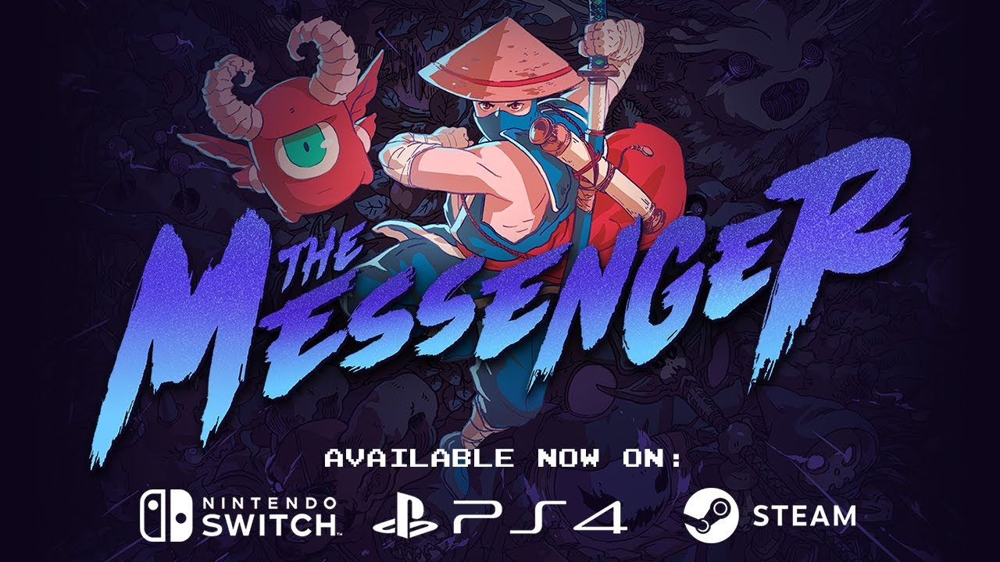

**Le Québec a maintenant son Chrono Trigger.**

En 2018, le studio québécois [Sabotage](https://sabotagestudio.com/) a pris d’assaut le monde du jeu vidéo avec un premier projet qui est devenu un classique instantané : The Messenger.

The Messenger se voulait une lettre d’amour aux jeux de ninjas de l’époque de la NES et SNES, principalement Ninja Gaiden; mais quiconque y a joué a vite compris qu’il ne s’agissait pas d’un simple hommage.

The Messenger dépasse les attentes des joueurs avec un jeu dont la profondeur prend pas surprise. En plus de son excellente jouabilité, le jeu est infusé d’humour, et c’était d’autant plus drôle quand on sélectionnait le mode « Québécois » pour les dialogues.

**À LIRE AUSSI : [Baldur’s Gate III : un succès retentissant en partie fait à Québec](/2023/08/14/baldurs-gate-iii-un-succes-retentissant-en-partie-fait-a-quebec/)**

Pour leur 2e projet, Sabotage a décidé de jouer encore avec le coeur nostalgique des joueurs qui ont grandi dans les années 90. Sea of Stars est clairement inspiré des Chrono Trigger et Secret of Mana qui ont marqué la console 16-bits de Nintendo.

Comme pour The Messenger, on peut s’attendre à bien plus qu’une simple lettre d’amour à ces jeux de rôle. (Et le retour du mode Québécois!)

En attendant de mettre la main sur Sea of Stars le 29 août prochain (sur PC, Switch, PlayStation ou Xbox selon votre préférence), vous pouvez découvrir le documentaire suivant sur le développement du jeu, produit pour la chaîne YouTube de The Escapist, un média américain dédié aux jeux vidéo.

https://www.youtube.com/watch?v=NvsDBAcKFDw

**À LIRE AUSSI : [Un 20e anniversaire pour le MIGS avec un retour aux sources et l’IA au coeur des préoccupations](/2023/08/10/un-20e-anniversaire-pour-le-migs-avec-un-retour-aux-sources/)**
