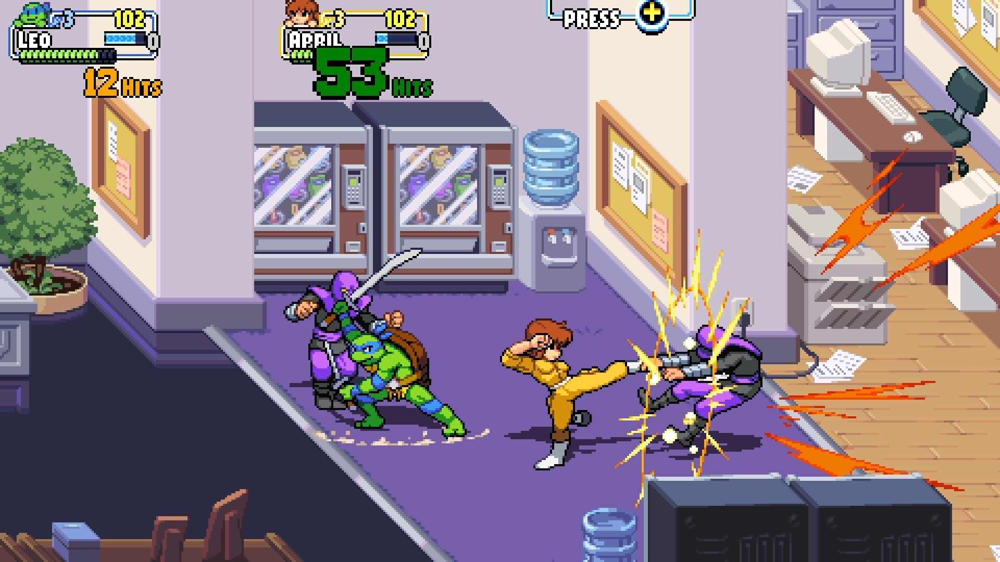

## Le studio québécois [Tribute Games](https://tributegames.com/) dévoile la date de lancement de Dimension Shellshock, un contenu téléchargeable pour Teenage Mutant Ninja Turtles : Shredder’s Revenge.

C’est le 31 août prochain que les joueurs de TMNT : Shredder’s Revenge pourront mettre la main sur le DLC que prépare Tribute Games. Le dévoilement de la date accompagne aussi l’annonce d’un autre personnage jouable : Karai.

Tribute Games, studio montréalais, nous propose depuis plusieurs années des jeux vidéo à saveur rétro, mais avec une jouabilité moderne. L’année dernière, on a eu droit au fruit de leur labeur sur la légendaire licence des tortues ninjas. Un excellent beat’em up disponible sur pratiquement toutes les plateformes, incluant sur mobile avec votre abonnement Netflix.

**À LIRE AUSSI : [Baldur’s Gate III : un succès retentissant en partie fait à Québec](/2023/08/14/baldurs-gate-iii-un-succes-retentissant-en-partie-fait-a-quebec/)**

Shredder’s Revenge s’inspire de la belle époque des beat’em up 16-bits, notamment du grand classique TMNT IV : Turtles in Time, avec une modernisation de la jouabilité et l’ajout de personnages secondaires comme Casey Jones, Master Splinter et April O’Neil comme protagonistes jouables.

Le DLC Dimension Shellshock propose aux joueurs deux nouveaux personnages jouables, Usagi Jimbo, un ronin lapin tiré de la bande dessinée du même nom, et Karai, un membre du foot clan qui serait la fille adoptive de Shredder.

On propose également un nouveau mode, Survival, ainsi que de nouvelles palettes de couleurs pour personnaliser nos fameux ninja.

**À LIRE AUSSI : [Un documentaire sur la création de Sea of Stars](/2023/08/15/un-documentaire-sur-la-creation-de-sea-of-stars/)**
