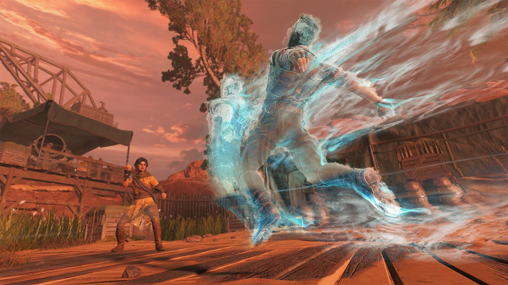
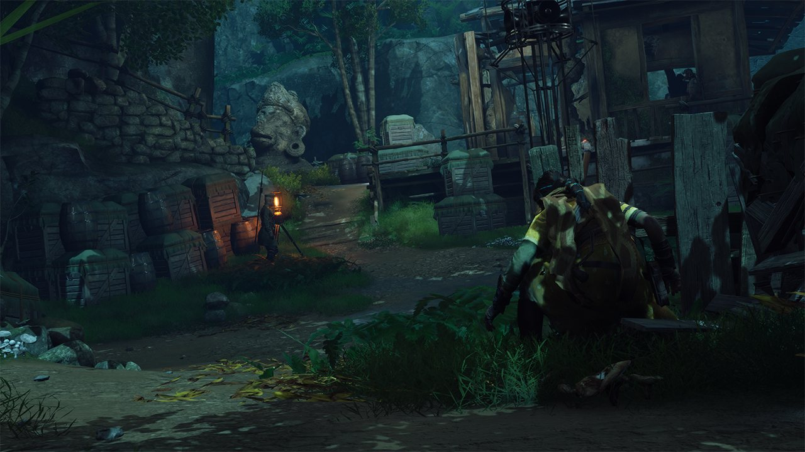
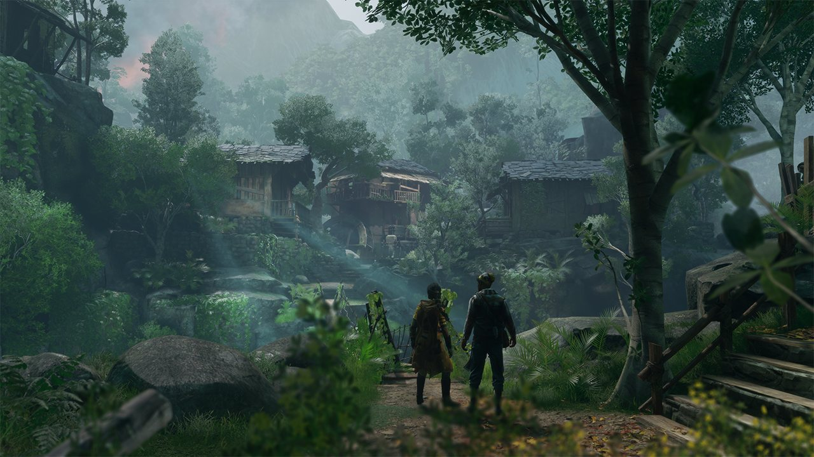
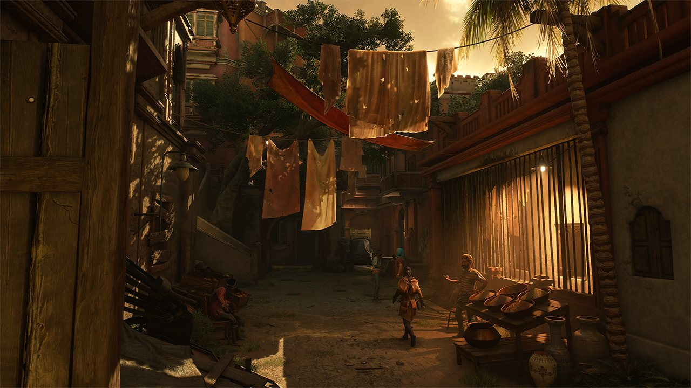

*copie du jeu et images gracieuseté de Reflector Entertainment*

**Le studio montréalais [Reflector Entertainment](https://reflectorentertainment.com/fr) nous livre avec [Unknown 9 : Awakening](https://store.steampowered.com/app/1477940/Unknown_9_Awakening/) sa première production sous l’égide de [Bandai Namco](https://www.bandainamcoent.com/). Si le jeu ne révolutionne pas son genre, il parvient à proposer une expérience solide et satisfaisante qui mérite qu’on s’y attarde.**

**Unknown 9 : Awakening** s’inscrit dans la lignée des jeux d’action-aventure à la troisième personne avec des éléments de furtivité. Le titre ne cherche pas à réinventer la roue, mais excelle dans l’exécution de mécaniques familières. Les séquences d’infiltration sont particulièrement réussies, offrant aux joueurs de multiples approches pour surmonter les obstacles.

Cela dit sans méchanceté : si les séquences de furtivité vous ont frustré dans **Star Wars : Outlaws**, je vous rassure que ça se passe beaucoup mieux dans **Unknown 9** : **Awakening**.

L’histoire se déroule au début du 20e siècle et suit Haroona, une jeune femme indienne qui découvre qu’elle est une Quaestor – une personne dotée de capacités surnaturelles liées au Revers, une dimension parallèle mystérieuse. Ces pouvoirs lui permettent de manipuler la réalité et d’interagir avec cette dimension cachée.

Dans le jeu, Haroona se retrouve mêlée à un conflit entre différentes factions qui cherchent à contrôler ces connaissances occultes. Son voyage l’emmène à travers l’Inde et d’autres parties de l’Asie et Europe, où elle doit apprendre à maîtriser ses pouvoirs tout en découvrant la vérité sur son héritage et les secrets que ces organisations tentent de protéger ou d’exploiter.

Haroona dispose d’un arsenal de capacités surnaturelles qui enrichissent considérablement l’expérience de jeu. La possibilité de manipuler l’environnement pour éliminer les ennemis ajoute une dimension stratégique. Le point fort du système de combat réside dans la capacité à prendre le contrôle des adversaires pour les retourner contre leurs alliés, créant des situations de jouabilité particulièrement satisfaisantes.

Sur le plan graphique, les décors et les lieux visités impressionnent par leur qualité visuelle et leur niveau de détail, créant une atmosphère immersive et captivante. Cependant, le rendu des personnages ne suit malheureusement pas la même excellence. Les animations faciales et corporelles manquent parfois de naturel, et la modélisation des visages reste en deçà des standards actuels. Cette disparité dessert particulièrement les performances des acteurs, malheureusement.

Les niveaux dans **Unknown 9 : Awakening** sont particulièrement linéaires; ne vous attendez donc pas à un jeu à monde ouvert. Par contre, il est toutefois possible d’explorer hors des sentiers battus et trouver des objets à collectionner et autres secrets.

Les contrôles sont précis, l’intelligence artificielle des ennemis est cohérente, et les possibilités tactiques sont suffisamment nombreuses pour permettre aux joueurs d’exprimer leur créativité dans l’approche des situations.

Sans révolutionner son genre, le jeu propose une expérience maîtrisée qui saura satisfaire les amateurs d’action-aventure et de furtivité. Le titre réussit particulièrement bien l’intégration de ses mécaniques de pouvoirs surnaturels, offrant aux joueurs des possibilités tactiques intéressantes et gratifiantes. Les amateurs du genre y trouveront une expérience familière, mais suffisamment bien exécutée pour mériter leur attention.

## Verdict : 7/10

**Unknown 9 : Awakening** est disponible sur [PC](https://store.steampowered.com/app/1477940/Unknown_9_Awakening/), [PlayStation](https://store.playstation.com/en-ca/concept/10001989/) et [Xbox.](https://www.xbox.com/en-US/auth/msa?action=logIn&returnUrl=%2Fen-US%2Fgames%2Fstore%2Funknown-9-awakening%2F9p486zcvt126&prompt=none)

**À LIRE AUSSI : [Two Falls : Nishu Takuatshina – entre deux mondes dans la Nouvelle-France](/2024/11/04/two-falls-nishu-takuatshina-entre-deux-mondes-dans-la-nouvelle-france/)**
