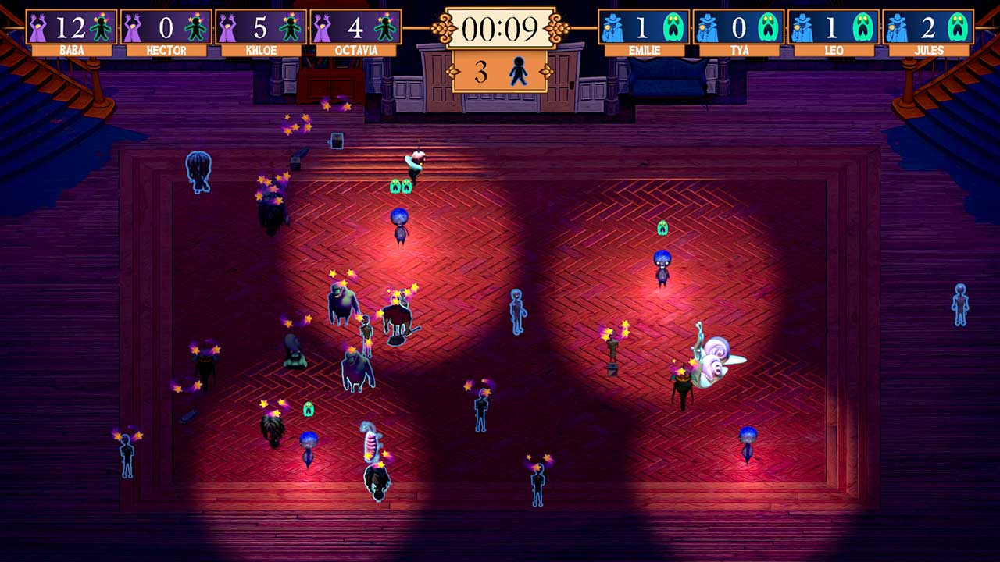
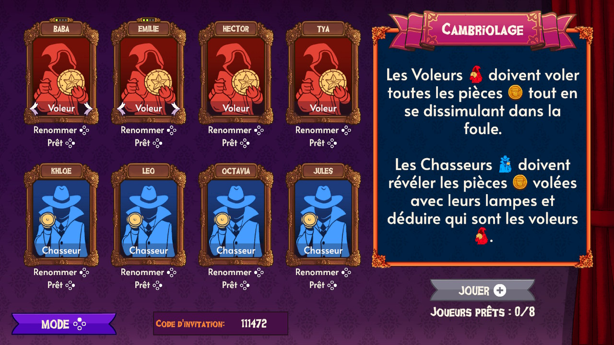
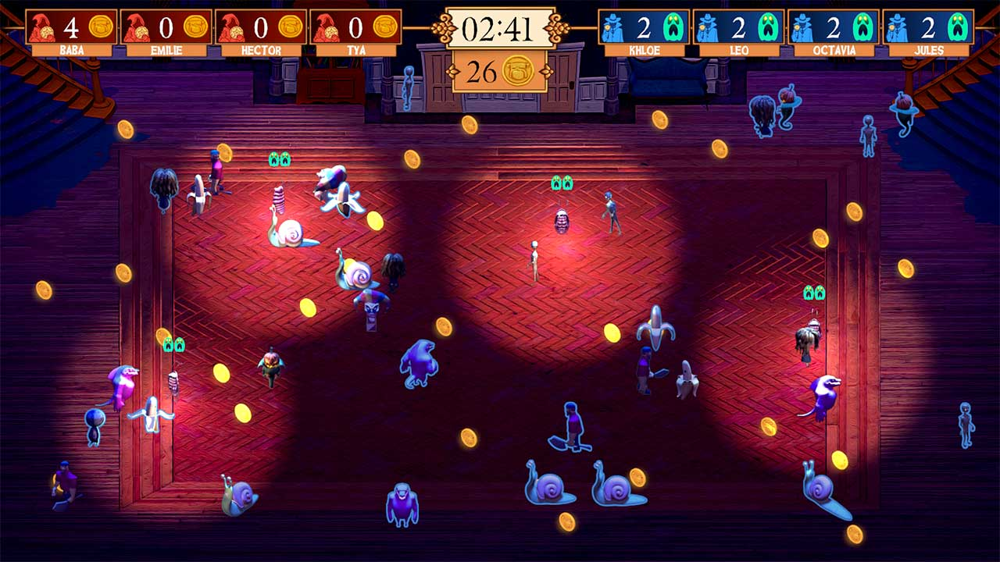

*image à la une gracieuseté de Dodo Tako/Triple Boris*

**Le studio québécois [Triple Boris](https://www.tripleboris.com/) annonce aujourd’hui la création d’un studio affilié, Dodo Tako, qui se consacre à la création de propriété intellectuelle et jeux originaux. Le premier jeu de Dodo Tako, [*Where is Billy?*](https://whereisbillygame.com/fr/), est disponible dès aujourd’hui sur Nintendo Switch et Nintendo Switch 2.**

***Where is Billy?*** est un jeu de party multijoueur où deux à huit joueurs s’affrontent dans différents modes de jeu inspirés du classique jeu de *cache-cache.* Dans un manoir remplie de monstres en perpétuel mouvement, le joueur doit se cacher dans une foule de monstres sans être repéré.

Cela dit, chaque mode de jeu propose des variations sur les mécaniques et règles:

- **Cambriolage**: les voleurs doivent prendre toutes les pièces sans se faire attraper par les chasseurs.
- **Frousstival**: les effrayeurs doivent effrayer tous les PNJ sans se faire capturer par les chasseurs.
- **Statues**: chaque infiltré doit toucher les statues autant de fois que possible sans se faire repérer.

Les modes *Course, Protection, Un, deux, trois, soleil*et*Aléatoire*sont aussi disponibles. De nouveaux modes de jeu seront ajoutés dans les prochaines mises à jour.

> « *[Where is Billy?](https://whereisbillygame.com/fr/) est le premier jeu multijoueur de notre histoire. De deux à huit personnes peuvent s’y amuser et il est possible d’y jouer localement ou en ligne. C’est le jeu de party parfait pour les moments entre amis ou en famille.* ».
>
> **– Simon Dansereau, président de Triple Boris**

***Where is Billy?*** est disponible sur [Nintendo Switch, Nintendo Switch 2](https://www.nintendo.com/en-ca/store/products/where-is-billy-switch/) et [Steam](https://store.steampowered.com/app/2228710/Where_is_Billy/#:~:text=Where%20is%20Billy%3F%20is%20a,objectives%20across%20multiple%20game%20modes.) au coût de 8.99$ CAD.

**À LIRE AUSSI : [Le « Great Canadian Game-Off » : MobileSyrup et l’ALD célèbrent le jeu vidéo canadien](/2025/07/09/le-great-canadian-game-off-mobilesyrup-et-lald-celebrent-le-jeu-video-canadien/)**
