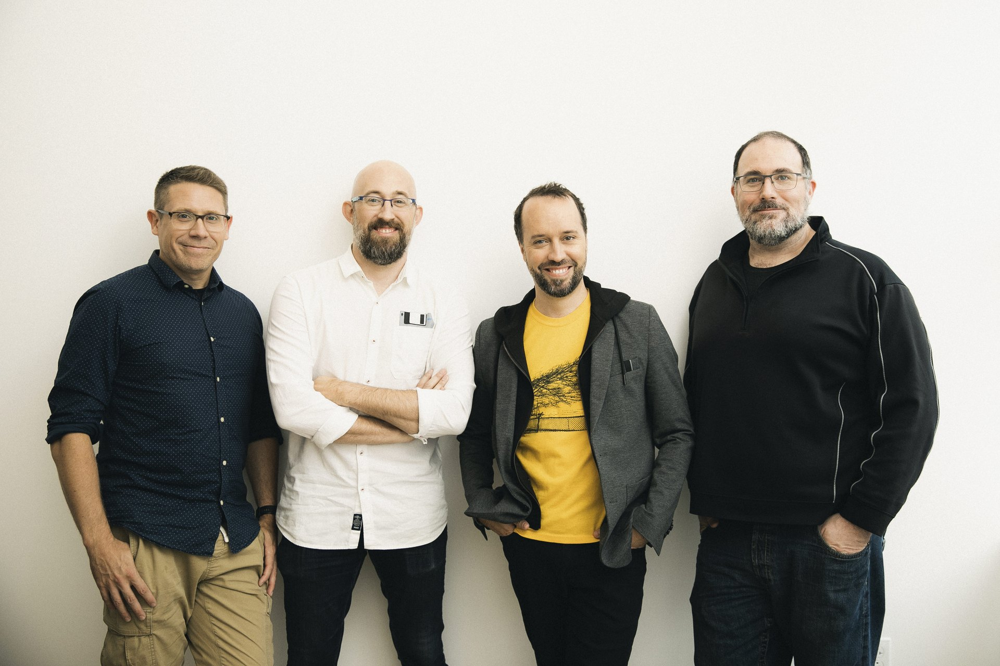

*images gracieuseté de Yellow Brick Games*

**Le studio québécois [Yellow Brick Games](https://yellowbrickgames.ca/) montre aujourd’hui un avant-goût de son premier jeu qui sera entièrement dévoilé le 2 avril 2024. Le studio se dissocie de l’éditeur américain précédemment attaché au projet et se lance dans l’autoédition.**

https://www.youtube.com/watch?v=arV9OC1ZiSw

Ce premier jeu du studio Yellow Brick Games, dont on ne connait pas encore le titre, en est d’action-aventure. L’équipe de 68 développeurs travaille d’arrache-pied sur cet ambitieux projet depuis 4 ans. Le changement de cap vers l’autoédition n’affecte pas le plan de publication en 2025.

Le dévoilement complet du projet, le 2 avril prochain, se fera en première sur la plateforme du média américain IGN dans le cadre de leur volet « IGN First »; ce qui est une visibilité incroyable pour l’éditeur de Québec qui a été fondé en 2020 par Thomas Giroux (président), Jeff Skalski (chef des opérations, producteur exécutif), Mike Laidlaw (chef de la création) et Frédéric St-Laurent B. (directeur du jeu).

> « On est ravis de partager cette nouvelle excitante avec notre communauté. L’autoédition est un saut dans l’inconnu, surtout dans le climat tumultueux actuel auquel l’industrie fait face, mais c’est aussi une opportunité de prendre notre destin en main et de nous adresser directement aux joueurs et plus largement à la communauté du jeu vidéo. Notre équipe travaille d’arrache-pied depuis des années, et on est impatients de finalement présenter notre premier projet au monde entier. C’est une étape importante pour nous, et c’est seulement le premier pas de ce qu’on espère être un long et enrichissant parcours pour le studio, en traçant notre propre chemin et en développant nos talents et nos jeux, brique par brique. »
>
> **– Mike Laidlaw, chef créatif chez Yellow Brick Games**

> « On voit ce changement d’un œil très positif puisqu’on contrôle désormais pleinement les ambitions de notre studio et que l’ampleur de notre jeu reste inchangée. Maintenant, le terme indépendant prend tout son sens. On a l’équipe et la détermination pour livrer ce premier jeu par nous-même. Le partage d’expérience et le soutien des studios voisins et de l’industrie est absolument incroyable! Le futur de l’industrie du jeu vidéo au Québec va passer par une expertise en commercialisation, et de cette manière, on y contribue tous ensemble. »
>
> **– Thomas Giroux, cofondateur et président chez Yellow Brick Games**

**À LIRE AUSSI : [Nine Dots Studio annonce Lost in Prayer et Outward 2](/2024/03/07/nine-dots-studio-annonce-lost-in-prayer-et-outward-2/)**
